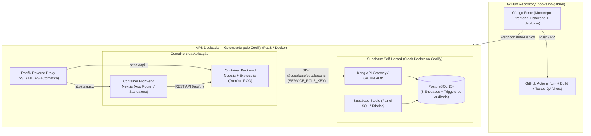
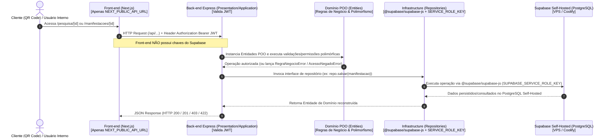

# Guia de Correção e Alinhamento Arquitetural: Front-end (Next.js), DevOps (VPS + Coolify) e Conexão Supabase Self-Hosted

**Projeto:** Plataforma de Experiência do Cliente (Cedro / NIT) — Substituição do INDECX  
**Arquivos Alvo para Correção/Alinhamento:** `docs/01-arquitetura-e-papeis.md`, `docs/03-modelagem-banco-dados.md`, `docs/04-contrato-api-e-plano-qa.md`, `README.md`, `backend/` e `frontend/`  
**Responsáveis:** Taino (`Back-end`, `Front-end` & `DevOps`) e Gabriel (`Tech Lead`, `Banco de Dados` & `QA`)

> [!IMPORTANT]
> **Instrução para a IA / Desenvolvedor:** Este documento unifica as **3 decisões arquiteturais definitivas** do projeto. Utilize este documento como fonte da verdade para corrigir a documentação existente (`docs/01-arquitetura-e-papeis.md` e `README.md`) e guiar toda a implementação de código do `frontend/`, `backend/` e infraestrutura, **sem gambiarras ou adaptações improvisadas**.

---

## PARTE 1: Refinamento Arquitetural do Front-end e Padrão de Rotas (Next.js App Router)

### 1.1. Contexto e Decisão Arquitetural de Front-end
O sistema utiliza uma arquitetura desacoplada:
1. **Back-end (`backend/`):** API REST em **Node.js + Express.js + TypeScript (POO Estrito)** em 4 camadas (`presentation`, `application`, `domain`, `infrastructure`), concentrando 100% das regras de negócio orientadas a objetos.
2. **Front-end (`frontend/`):** Aplicação **Next.js (React + TypeScript)** utilizando o **App Router** (`src/app/`).

**Por que manter Next.js (SPA Híbrida com Múltiplas Rotas) com URLs bem definidas?**
* **Navegação fluida de SPA (Single-Page Application):** Transições entre telas ocorrem via roteamento no cliente (sem *full page reload*).
* **Links Profundos e Compartilháveis (Deep Linking):** Cada módulo, filtro e manifestação possui uma URL única, semântica e persistente. Se a Ouvidoria escalonar uma manifestação e enviar o link para um gestor ou Coordenador de Unidade, o link abrirá diretamente o caso exato.

### 1.2. Diagnóstico da Estrutura Antiga (`docs/01-arquitetura-e-papeis.md#L118-130`)
Na versão inicial da documentação, a pasta `frontend/` estava definida de forma simplificada demais, o que geraria 3 problemas técnicos graves na implementação:

1. **Mistura de Layouts sem *Route Groups* (`(publico)`, `(auth)`, `(sistema)`):**
   * A rota pública do cliente (`/pesquisa/[id]`, acessada via QR Code/Link) e a tela de `/login` estavam no mesmo nível hierárquico das 8 telas internas.
   * **Impacto:** As telas internas precisam de um *App Shell* corporativo (Sidebar lateral, Header com perfil/unidade do usuário logado e verificação de sessão JWT). Já a pesquisa pública e o login não podem ter Sidebar nem exigir autenticação prévia. Sem *Route Groups* do Next.js, seria necessário fazer condicionais improvisadas (`if (pathname !== '/login')`) no `layout.tsx` raiz.
   * **Solução:** Utilizar *Route Groups* com parênteses — `(publico)`, `(auth)` e `(sistema)`. No Next.js, pastas entre parênteses organizam layouts e proteção de rotas **sem alterar a URL final**.

2. **Acoplamento das Telas 4 e 5 na mesma rota (`manifestacoes/`):**
   * A Tela 4 (Listagem com filtros da Seção 10) e a Tela 5 (Detalhe da Manifestação com os 14 campos da Seção 9, histórico imutável de interações e ações de resposta/escalonamento/conclusão) estavam agrupadas em uma única pasta `manifestacoes/`.
   * **Impacto:** Sem a sub-rota dinâmica `manifestacoes/[id]`, o detalhe da manifestação não teria um link próprio e compartilhável.
   * **Solução:** Explicitar `/manifestacoes` (Tela 4, usando *URL Query Params* para filtros compartilháveis) e `/manifestacoes/[id]` (Tela 5, rota dinâmica dedicada para o detalhe e tratativa da manifestação).

3. **Ausência de Camadas de Arquitetura Front-end (`services/`, `contexts/`, `types/`, `middleware.ts`):**
   * Existiam apenas `app/` e `components/`.
   * **Impacto:** Chamadas `fetch` diretas nos componentes causariam duplicação de código para envio do token JWT, tratamento de erros HTTP (`401 Unauthorized`, `403 Forbidden`, `422 RegraNegocioError`) e checagem de permissões por perfil (`ADMINISTRADOR`, `OPERADOR_OUVIDORIA`, `COORDENADOR_UNIDADE`).
   * **Solução:** Adicionar camadas formais de `services/` (clientes HTTP por módulo), `contexts/` (estado de autenticação e RBAC no cliente), `types/` (contratos TypeScript espelhados do `docs/04-contrato-api-e-plano-qa.md`) e `middleware.ts` (proteção de rotas privadas antes da renderização).

### 1.3. Nova Estrutura Oficial do `frontend/` (Substituir linhas 118–130 do `docs/01-arquitetura-e-papeis.md`)

```text
└── frontend/                                  # (Frente: Front-end - Taino) Aplicação Next.js (App Router)
    └── src/
        ├── app/
        │   ├── (publico)/                     # Grupo Público: Layout limpo (Mobile-first p/ QR Code, sem Auth)
        │   │   └── pesquisa/[id]/             # URL: /pesquisa/:id (Formulário público do cliente: nota 1-5 + comentário)
        │   │       └── page.tsx
        │   │
        │   ├── (auth)/                        # Grupo de Autenticação: Layout centralizado sem Sidebar
        │   │   └── login/                     # URL: /login (Tela 1: Login de usuários internos)
        │   │       └── page.tsx
        │   │
        │   └── (sistema)/                     # Grupo Interno: Layout Corporativo (Sidebar, Header e AuthGuard RBAC)
        │       ├── layout.tsx                 # Shell autenticado compartilhado pelas telas 2 a 9
        │       ├── dashboard/                 # URL: /dashboard (Tela 2: Dashboard Gerencial - 10 indicadores)
        │       ├── pesquisas/                 # URL: /pesquisas (Tela 3: Gestão de Pesquisas e geração de links)
        │       ├── manifestacoes/             # URL: /manifestacoes (Tela 4: Lista com Filtros via Query Params)
        │       │   ├── page.tsx
        │       │   └── [id]/                  # URL: /manifestacoes/:id (Tela 5: Detalhe, Histórico e Tratativa)
        │       │       └── page.tsx
        │       ├── pendencias/                # URL: /pendencias (Tela 6: Não respondidas, Atrasadas e Escalonadas)
        │       ├── unidades/                  # URL: /unidades (Tela 7: Cadastro e Gestão de Unidades)
        │       ├── usuarios/                  # URL: /usuarios (Tela 8: Gestão de Usuários, Perfis e Unidades)
        │       └── relatorios/                # URL: /relatorios (Tela 9: Relatórios Gerenciais e Exportação CSV)
        │
        ├── components/                        # Componentes visuais modulares e reutilizáveis
        │   ├── ui/                            # Primitivos visuais (Botões, Badges de Status/SLA, Tabelas, Modais)
        │   ├── layout/                        # Sidebar dinâmica por perfil, Header, Breadcrumbs
        │   └── manifestacoes/                 # Timeline de Interações, Formulário de Resposta da Unidade, Modal de Escalonamento
        ├── services/                          # Camada de comunicação HTTP com o Back-end Express (/api/...)
        │   ├── api-client.ts                  # Instância HTTP centralizada (Injeção de JWT e tratamento 401/403)
        │   ├── auth.service.ts
        │   ├── pesquisas.service.ts
        │   ├── manifestacoes.service.ts
        │   └── dashboard.service.ts
        ├── contexts/                          # Estado global da sessão (AuthContext: Usuário, Perfil e Unidade vinculada)
        ├── types/                             # Interfaces e DTOs TypeScript alinhados ao Contrato da API (Doc 04)
        └── middleware.ts                      # Proteção de rotas no Next.js (Redireciona não autenticados para /login)
```

### 1.4. Mapa Oficial de URLs e Links (Deep Linking)

| Contexto | Padrão de URL | Acesso / Comportamento |
| :--- | :--- | :--- |
| **Cliente (QR Code / Link)** | `/pesquisa/[id]` | **Público.** Abre direto o formulário de avaliação da pesquisa ativa. |
| **Autenticação Interna** | `/login` | **Público.** Redireciona para `/dashboard` se já estiver autenticado. |
| **Visão Executiva** | `/dashboard` | **Autenticado.** Exibe indicadores filtrados pelo escopo do perfil logado. |
| **Gestão de Pesquisas** | `/pesquisas` | **Admin / Ouvidoria.** Criação de pesquisas e cópia do link público `/pesquisa/[id]`. |
| **Lista de Manifestações** | `/manifestacoes?status=NAO_RESPONDIDA&nota=1` | **Autenticado.** Filtros sincronizados na URL (*Query Params*) permitindo compartilhar buscas. |
| **Detalhe e Tratativa** | `/manifestacoes/[id]` | **Autenticado.** Link direto para o protocolo, exibindo a trilha de auditoria e botões de ação conforme o perfil polimórfico (`COORDENADOR_UNIDADE` responde; `OPERADOR_OUVIDORIA`/`ADMINISTRADOR` solicita complemento, escalona ou conclui). |
| **Fila de Urgência (SLA)** | `/pendencias` | **Autenticado.** Foco operacional em manifestações não respondidas, atrasadas ou escalonadas. |
| **Administração** | `/unidades` e `/usuarios` | **Admin (e consulta Ouvidoria).** Governança de unidades, SLAs e perfis de acesso. |
| **Extração de Dados** | `/relatorios` | **Admin / Ouvidoria.** Consolidação e exportação CSV/JSON. |

---

## PARTE 2: DevOps & Infraestrutura Real: VPS + Coolify (PaaS) + Supabase Self-Hosted

### 2.1. O Ponto de Correção na Documentação
Na versão inicial de `docs/01-arquitetura-e-papeis.md` (linha 16), a camada de **DevOps & Infra** mencionava `Supabase/Vercel`.  
Essa menção **deve ser removida e corrigida**, pois:
* **Não usaremos Vercel nem Supabase Cloud.**
* **Usaremos o Coolify como PaaS em uma VPS dedicada**, e o **Supabase também será Self-Hosted na mesma VPS**.

### 2.2. Justificativa Técnica da Infraestrutura (VPS + Coolify + Supabase Self-Hosted)
1. **Containers Reais para Back-end Express.js (POO) e Front-end Next.js:**
   * Na Vercel, o modelo Serverless dificulta rodar um servidor Express.js tradicional orientado a objetos com processos persistentes.
   * No **Coolify (VPS)**, tanto o `backend/` (Express.js) quanto o `frontend/` (Next.js `standalone`) rodam como containers Docker reais, sem *cold start* e sem adaptações serverless.
2. **Latência Quase Zero (Rede Interna Docker na mesma VPS):**
   * Como o **Back-end Express** e o **Supabase Self-Hosted (PostgreSQL)** estão na mesma VPS gerenciada pelo Coolify, as consultas e gravações trafegam em rede interna de containers, com resposta imediata.
3. **Disponibilidade 24/7 sem Pausa de Free Tier:**
   * O Supabase Self-Hosted na VPS mantém o PostgreSQL, as *triggers* de imutabilidade (`interacoes`) e o **Supabase Studio** ativos 24/7 sob controle total da equipe.
4. **Domínios Limpos e HTTPS Automático (Traefik / Let's Encrypt):**
   * Front-end (Next.js): `https://app.seudominio.com` (QR Code: `https://app.seudominio.com/pesquisa/[id]`)
   * Back-end (API Express): `https://api.seudominio.com`
   * Supabase Self-Hosted (Studio / Kong): `https://supabase.seudominio.com`

### 2.3. Diagrama da Arquitetura de Deploy na VPS (Coolify)



---

## PARTE 3: Padrão de Conexão ao Supabase (Opção A), Isolamento de Credenciais e Segurança

### 3.1. Regras Inegociáveis de Comunicação entre Camadas

1. **Front-end (`frontend/` — Next.js) ➔ Conhece APENAS o link do Back-end (`NEXT_PUBLIC_API_URL`):**
   * O Front-end **NÃO possui** `@supabase/supabase-js` instalado e **NÃO armazena nenhuma credencial ou URL do Supabase**.
   * **Motivo Acadêmico (POO):** Todas as regras de negócio (`Manifestacao.concluir()`, cálculo de SLA, abertura automática de protocolo) e o polimorfismo de permissões (`usuario.podeResponderUnidade()`, `usuario.podeVisualizar()`) estão nas **Classes de Domínio POO do Back-end** (`backend/src/domain/`). Se o Front-end consultasse o Supabase diretamente, burlaria a camada POO.
   * **Motivo de Segurança:** O navegador do cliente (especialmente na rota pública `/pesquisa/[id]` do QR Code) jamais tem visibilidade sobre o banco de dados. Toda requisição do Front-end vai para o Back-end Express (`/api/...`) autenticada com **JWT** (`Authorization: Bearer <token>`).

2. **Back-end (`backend/` — Express + POO) ➔ Conecta ao Supabase Self-Hosted via Opção A (`@supabase/supabase-js` + `SUPABASE_SERVICE_ROLE_KEY`):**
   * A conexão com o Supabase fica **100% isolada na Camada 4 (`backend/src/infrastructure/`)**, dentro das classes concretas de Repositório (`SupabaseManifestacaoRepository`, `SupabaseUsuarioRepository`, etc.) que implementam as interfaces de `backend/src/domain/repositories/`.
   * O Back-end utiliza o pacote `@supabase/supabase-js` (já presente em `backend/package.json`) com `SUPABASE_URL` e `SUPABASE_SERVICE_ROLE_KEY`.
   * **Por que `SERVICE_ROLE_KEY` no Back-end?** Porque a autenticação (`POST /api/auth/login` validando `senha_hash` na tabela `usuarios`) e a autorização polimórfica por perfil/unidade já são executadas pelo próprio Domínio POO no Back-end antes de chamar o Repositório. O Back-end atua como *Trusted Server* na rede interna da VPS.

### 3.2. Fluxo de Requisição Ponta a Ponta



### 3.3. Padrão Oficial de Variáveis de Ambiente (`.env.example`)

#### No Front-end (`frontend/.env.example`)
```env
# =============================================================================
# FRONT-END (Next.js) — Variáveis de Ambiente
# REGRA DE SEGURANÇA: NUNCA adicione chaves ou URLs do Supabase neste arquivo!
# O Front-end comunica-se exclusivamente com o Back-end Express.
# =============================================================================

NEXT_PUBLIC_API_URL=http://localhost:3001/api
```

#### No Back-end (`backend/.env.example`)
```env
# =============================================================================
# BACK-END (Node.js + Express + POO) — Variáveis de Ambiente (Server-Only)
# =============================================================================

PORT=3001
NODE_ENV=development
CORS_ORIGIN=http://localhost:3000

# Autenticação JWT gerenciada pelo Back-end
JWT_SECRET=substitua_por_uma_chave_secreta_forte_em_producao
JWT_EXPIRES_IN=8h

# Conexão Opção A: SDK @supabase/supabase-js com Supabase Self-Hosted na VPS (Coolify)
# Uso estritamente restrito à pasta backend/src/infrastructure/
SUPABASE_URL=https://supabase.seudominio.com
SUPABASE_SERVICE_ROLE_KEY=substitua_pela_service_role_key_do_supabase_self_hosted
```

### 3.4. Padrão de Instanciação do Cliente Supabase (`backend/src/infrastructure/database/supabaseClient.ts`)

```typescript
import { createClient } from '@supabase/supabase-js';
import dotenv from 'dotenv';

dotenv.config();

const supabaseUrl = process.env.SUPABASE_URL;
const supabaseServiceRoleKey = process.env.SUPABASE_SERVICE_ROLE_KEY;

if (!supabaseUrl || !supabaseServiceRoleKey) {
  throw new Error(
    'Erro de Infraestrutura: SUPABASE_URL e SUPABASE_SERVICE_ROLE_KEY são obrigatórios no ambiente do Back-end.'
  );
}

/**
 * Instância única do Supabase restrita à Camada 4 (Infrastructure) do Back-end.
 * Utiliza SUPABASE_SERVICE_ROLE_KEY pois toda autenticação (JWT) e autorização
 * polimórfica (Usuario -> Administrador / OperadorOuvidoria / CoordenadorUnidade)
 * é validada previamente pela Camada de Domínio POO.
 */
export const supabase = createClient(supabaseUrl, supabaseServiceRoleKey, {
  auth: {
    persistSession: false,
    autoRefreshToken: false,
  },
});
```

---

## PARTE 4: Guia Exato de Substituição na Documentação Existente ("De ➔ Para")

### 4.1. Atualizar Tabela da Stack Tecnológica em `docs/01-arquitetura-e-papeis.md` (Linhas 13–16)

**Substituir por:**
```markdown
| **Banco de Dados & Auth** | **PostgreSQL (Supabase Self-Hosted na VPS)** | Instância própria do Supabase (PostgreSQL + Studio) hospedada na VPS, acessada exclusivamente pelo Back-end via `@supabase/supabase-js` (`SERVICE_ROLE_KEY`), garantindo integridade referencial das 8 entidades e histórico imutável (`interacoes`). |
| **Front-end** | **Next.js (App Router + React + TypeScript)** | SPA híbrida com rotas dedicadas e *Route Groups* (`(publico)`, `(auth)`, `(sistema)`), consumindo exclusivamente a API REST do Back-end (`NEXT_PUBLIC_API_URL`) sem exposição do banco. |
| **Qualidade (QA)** | **Vitest / Jest + Supertest** | Testes unitários em memória focados nas regras de negócio das classes POO e testes de integração nos endpoints da API Express. |
| **DevOps & Infra** | **VPS + Coolify (PaaS Docker) + GitHub Actions** | Deploy contínuo (CI/CD) via **Coolify** orquestrando containers Docker para o Front-end (Next.js), Back-end (Express.js) e **Supabase Self-Hosted** na mesma VPS com SSL automático. |
```

### 4.2. Atualizar Responsabilidades de Front-end e DevOps do Taino em `docs/01-arquitetura-e-papeis.md` (Linhas 43–48)

**Substituir por:**
```markdown
5. **Front-end (Next.js App Router)**
   * Estruturar a aplicação com *Route Groups* isolados (`(publico)`, `(auth)`, `(sistema)`), garantindo links limpos e compartilháveis (incluindo rota dinâmica `/manifestacoes/[id]` e filtros via *Query Params*).
   * Desenvolver a página pública de resposta da pesquisa (`/pesquisa/[id]` via link/QR Code) e as **9 telas internas** consumindo exclusivamente a API Express do Back-end (`NEXT_PUBLIC_API_URL`) através de uma camada dedicada de `services/`.
6. **DevOps (Infraestrutura VPS, Coolify e Deploy)**
   * Estruturar o repositório, padronizar variáveis de ambiente isoladas (`frontend/.env.example` apenas com a URL da API e `backend/.env.example` com `SUPABASE_URL` e `SUPABASE_SERVICE_ROLE_KEY`) e pipeline de CI no GitHub Actions.
   * Provisionar e gerenciar na **VPS via Coolify (PaaS)** os containers do **Front-end (Next.js)**, do **Back-end (API Express)** e da instância **Supabase Self-Hosted (PostgreSQL)**, incluindo domínios e HTTPS.
```

### 4.3. Atualizar Stack Tecnológica no `README.md` (Linhas 16–22)

**Substituir por:**
```markdown
* **Linguagem:** TypeScript (Strict Mode)
* **Back-end:** Node.js + Express.js (Arquitetura Limpa em 4 Camadas com Domínio POO Puro)
* **Front-end:** Next.js (App Router + React + TypeScript — consome exclusivamente a API do Back-end)
* **Banco de Dados:** PostgreSQL via **Supabase Self-Hosted na VPS** (acessado exclusivamente pela camada `infrastructure/` do Back-end via `@supabase/supabase-js` com `SERVICE_ROLE_KEY`)
* **Testes / QA:** Vitest + Supertest
* **DevOps & PaaS:** **VPS + Coolify** (Orquestração Docker para Front-end, Back-end e Supabase Self-Hosted) + GitHub Actions
```
