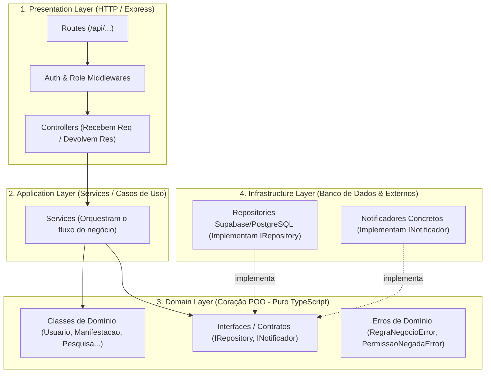

# 01. Arquitetura do Sistema, Stack e Divisão das 6 Frentes — Plataforma de Experiência do Cliente (Cedro / NIT)

Este documento estabelece a fundação arquitetural da **Plataforma de Experiência do Cliente (Cedro / NIT)** — sistema próprio construído para **substituir o antigo sistema INDECX**, traduzindo a [Documentacao_Funcional_INDECX.pdf](file:///c:/Users/gabri/poo-taino-gabriel/Documentacao_Funcional_INDECX.pdf) em decisões técnicas concretas para a dupla **Gabriel** e **Taino**.

---

## 1. Stack Tecnológica Oficial

| Camada | Tecnologia Escolhida | Justificativa Técnica e Acadêmica (POO) |
| :--- | :--- | :--- |
| **Linguagem Base** | **TypeScript** (Strict Mode) | Suporte completo a Orientação a Objetos estaticamente tipada (`abstract class`, `interface`, modificadores `private`/`protected`/`readonly`, herança e polimorfismo). |
| **Back-end (API)** | **Node.js + Express.js** | Permite estruturar uma arquitetura limpa em camadas onde o coração do sistema são as **Classes de Domínio POO**, sem que o framework esconda a lógica orientada a objetos avaliada pelo professor. |
| **Banco de Dados & Auth** | **PostgreSQL (Supabase Self-Hosted na VPS)** | Instância própria do Supabase (PostgreSQL + Studio) hospedada na VPS, acessada exclusivamente pelo Back-end via `@supabase/supabase-js` (`SERVICE_ROLE_KEY`), garantindo integridade referencial das 8 entidades e histórico imutável (`interacoes`). |
| **Front-end** | **Next.js (App Router + React + TypeScript)** | SPA híbrida com rotas organizadas em *Route Groups* (`(publico)`, `(auth)`, `(sistema)`), consumindo exclusivamente a API REST do Back-end (`NEXT_PUBLIC_API_URL`) sem expor credenciais do banco no navegador. |
| **Qualidade (QA)** | **Vitest / Jest + Supertest** | Testes unitários focados nas regras de negócio das classes POO e testes de integração nos endpoints da API Express. |
| **DevOps & Infra** | **VPS + Coolify (PaaS Docker) + GitHub Actions** | Deploy contínuo (CI/CD) via **Coolify** orquestrando containers Docker para o Front-end (Next.js), Back-end (Express.js) e **Supabase Self-Hosted** na mesma VPS com SSL automático. |

---

## 2. Divisão Oficial das 6 Arquiteturas / Frentes (Gabriel & Taino)

Para cumprir a exigência do professor sem sobrecarregar nenhum dos dois, cada frente tem entregáveis claros na fase de planejamento e na fase de código:

### Responsabilidades do Gabriel (`Tech Lead` + `Banco de Dados` + `QA`)

1. **Tech Lead (Arquitetura e Padrões POO)**
   * Garantir que o código siga os 4 pilares de POO (Abstração, Encapsulamento, Herança e Polimorfismo).
   * Definir e manter os contratos da API REST entre o Back-end e o Front-end.
   * Revisar Pull Requests e garantir a ordem das **9 entregas do MVP** (Seção 14 do PDF).
2. **Banco de Dados (PostgreSQL / Supabase)**
   * Modelar e manter o schema SQL das **8 entidades** (Seção 8 do PDF).
   * Configurar chaves primárias (`PK`), chaves estrangeiras (`FK`), `ENUM`s, índices de busca (Seção 10) e triggers de imutabilidade do histórico (Seções 6 e 13).
   * Fornecer as credenciais de conexão e camada base de acesso a dados para o Back-end.
3. **QA (Qualidade e Testes)**
   * Escrever e executar os testes unitários das classes de domínio (`Manifestacao`, `Usuario`, `RespostaPesquisa`) validando as regras da Seção 6.
   * Validar os critérios de aceite de cada entrega até o **Critério de Conclusão do MVP** (Seção 16).

### Responsabilidades do Taino (`Back-end` + `Front-end` + `DevOps`)

4. **Back-end (API Express + Implementação POO)**
   * Implementar as classes de domínio orientadas a objetos, casos de uso (`Services`), `Controllers` e `Middlewares` de autenticação/autorização no Express.js.
   * Expor os endpoints REST para pesquisas, manifestações, tratativas da unidade, escalonamentos, conclusão, indicadores do dashboard e CRUD completo com *Soft Delete* (`GET /:id` e `PATCH /:id` para pesquisas, unidades e usuários).
5. **Front-end (Next.js App Router)**
   * Estruturar a aplicação com *Route Groups* isolados (`(publico)`, `(auth)`, `(sistema)`), garantindo links compartilháveis (incluindo rotas dinâmicas por ID `/manifestacoes/[id]`, `/pesquisas/[id]`, `/unidades/[id]`, `/usuarios/[id]` e filtros via *Query Params*).
   * Desenvolver a página pública de resposta da pesquisa (`/pesquisa/[id]` via link/QR Code) e as telas internas (listagens + páginas de detalhe e gestão por `[id]`) consumindo exclusivamente a API Express do Back-end (`NEXT_PUBLIC_API_URL`) através de uma camada dedicada de `services/`.
6. **DevOps (Infraestrutura VPS, Coolify e Deploy)**
   * Estruturar o repositório, padronizar variáveis de ambiente isoladas (`frontend/.env.example` apenas com a URL da API e `backend/.env.example` com `SUPABASE_URL` e `SUPABASE_SERVICE_ROLE_KEY`) e pipeline de CI no GitHub Actions.
   * Provisionar e gerenciar na **VPS via Coolify (PaaS)** os containers do **Front-end (Next.js)**, do **Back-end (API Express)** e da instância **Supabase Self-Hosted (PostgreSQL)**, incluindo domínios e HTTPS.

---

## 3. Arquitetura em Camadas do Back-end (Foco em POO)

Para que o professor de POO veja claramente a aplicação de Orientação a Objetos, o Back-end **não** colocará SQL ou regras de negócio soltas dentro das rotas do Express. Usaremos uma **Arquitetura em 4 Camadas**:



### Regra de Ouro da Arquitetura
* A pasta `domain/` (**Camada 3**) **não importa Express nem Supabase**. Ela contém apenas classes TypeScript puras, herança, encapsulamento e regras de negócio da [Documentacao_Funcional_INDECX.pdf](file:///c:/Users/gabri/poo-taino-gabriel/Documentacao_Funcional_INDECX.pdf).
* Isso permite que o **Gabriel (QA)** rode testes automatizados nas classes de POO em milissegundos, e que o professor avalie os conceitos de POO de forma cristalina.

---

## 4. Estrutura de Pastas Padrão do Repositório

```text
poo-taino-gabriel/
├── Documentacao_Funcional_INDECX.pdf
├── docs/                                  # Documentação Técnica de Engenharia
│   ├── 01-arquitetura-e-papeis.md
│   ├── 02-modelagem-poo-dominio.md
│   ├── 03-modelagem-banco-dados.md
│   ├── 04-contrato-api-e-plano-qa.md
│   └── 05-diagramas-uml-casos-de-uso.md
├── database/                              # (Frente: Banco de Dados - Gabriel)
│   ├── schema.sql                         # DDL completo para PostgreSQL / Supabase
│   └── seed.sql                           # Dados iniciais para testes (Unidades, Perfis, Pesquisa)
├── backend/                               # (Frente: Back-end POO - Taino | QA - Gabriel)
│   ├── src/
│   │   ├── domain/                        # NÚCLEO POO (Classes, Herança, Polimorfismo, Interfaces)
│   │   │   ├── entities/                  # Usuario, Unidade, Pesquisa, Resposta, Manifestacao, etc.
│   │   │   ├── enums/                     # StatusManifestacao, PerfilUsuario, Prioridade
│   │   │   ├── errors/                    # RegraNegocioError, AcessoNegadoError
│   │   │   ├── repositories/              # Interfaces IManifestacaoRepository, IUsuarioRepository...
│   │   │   └── services/                  # Interfaces INotificador
│   │   ├── application/                   # Casos de Uso / Services que orquestram o domínio
│   │   ├── infrastructure/                # Implementação Supabase/Postgres dos Repositórios
│   │   └── presentation/                  # Controllers, Middlewares e Rotas Express.js
│   └── tests/                             # (Frente: QA - Gabriel) Testes unitários POO e integração
└── frontend/                              # (Frente: Front-end - Taino) Aplicação Next.js (App Router)
    └── src/
        ├── app/
        │   ├── (publico)/                 # Grupo Público: Layout limpo (Mobile-first p/ QR Code, sem Auth)
        │   │   └── pesquisa/              # URL: /pesquisa (Seleção de pesquisa ativa)
        │   │       └── [id]/              # URL: /pesquisa/:id (Formulário público do cliente: nota 1-5 + comentário)
        │   ├── (auth)/                    # Grupo de Autenticação: Layout centralizado sem Sidebar
        │   │   └── login/                 # URL: /login (Tela 1: Login de usuários internos)
        │   └── (sistema)/                 # Grupo Interno: Layout Corporativo (Sidebar, Header e AuthGuard)
        │       ├── layout.tsx             # Shell autenticado compartilhado pelas telas internas
        │       ├── dashboard/             # URL: /dashboard (Tela 2: Dashboard Gerencial)
        │       ├── pesquisas/             # URL: /pesquisas (Tela 3: Listagem e Criação de Pesquisas)
        │       │   └── [id]/              # URL: /pesquisas/:id (Detalhe, Indicadores da Pesquisa, Link/QR Code, Edição e Soft Delete)
        │       ├── manifestacoes/         # URL: /manifestacoes (Tela 4: Lista com Filtros via Query Params)
        │       │   └── [id]/              # URL: /manifestacoes/:id (Tela 5: Detalhe, Histórico e Tratativa)
        │       ├── pendencias/            # URL: /pendencias (Tela 6: Não respondidas, Atrasadas e Escalonadas)
        │       ├── unidades/              # URL: /unidades (Tela 7: Listagem e Cadastro de Unidades)
        │       │   └── [id]/              # URL: /unidades/:id (Detalhe, Indicadores por Pesquisa, Coordenadores, Edição e Soft Delete)
        │       ├── usuarios/              # URL: /usuarios (Tela 8: Listagem e Cadastro de Usuários)
        │       │   └── [id]/              # URL: /usuarios/:id (Ficha do Usuário, Histórico de Atuação, Edição e Soft Delete)
        │       └── relatorios/            # URL: /relatorios (Tela 9: Relatórios e Exportação)
        ├── components/                    # Componentes visuais reutilizáveis (ui/, layout/, manifestacoes/)
        ├── services/                      # Comunicação HTTP com o Back-end Express (/api/...)
        ├── contexts/                      # Estado global da sessão (AuthContext)
        ├── types/                         # Interfaces e DTOs TypeScript alinhados ao Contrato da API
        └── middleware.ts                  # Proteção de rotas privadas no Next.js
```

### 4.1. Mapa de Rotas Internas por Artefato (`Listagem` + `Página Dedicada /[id]`)

Todos os 4 artefatos principais do sistema contam com **Tela de Listagem** e **Página Individual por ID (`/[id]`)** para análise de indicadores, auditoria, edição e desativação lógica (*Soft Delete*):

| Módulo | Rota de Listagem | Rota de Detalhe (`/[id]`) | Escopo da Página por ID (`/[id]`) |
| :--- | :--- | :--- | :--- |
| **Manifestações** | `/manifestacoes` | `/manifestacoes/[id]` | Dados do atendimento, nota, comentário, prazo SLA, linha do tempo imutável e ações de fluxo (iniciar tratativa, responder pela unidade, solicitar complemento, escalonar, redirecionar unidade e concluir). |
| **Pesquisas** | `/pesquisas` | `/pesquisas/[id]` | **Indicadores da pesquisa:** total de respostas, nota média, % de satisfação e distribuição de notas (1 a 5). **Divulgação:** link público (`/pesquisa/:id`) e QR Code. **Listagem:** últimas manifestações geradas. **Gestão (Admin):** editar título, descrição, período, canal e ativar/desativar (*Soft Delete*). |
| **Unidades** | `/unidades` | `/unidades/[id]` | **Indicadores da unidade:** total de manifestações, pendências abertas/atrasadas e nota média geral. **Desempenho por pesquisa:** pesquisas respondidas na unidade com nº de respostas e nota média. **Equipe:** coordenadores alocados. **Gestão (Admin):** editar nome, responsável, prazo SLA padrão (em horas) e ativar/desativar (*Soft Delete*). |
| **Usuários** | `/usuarios` | `/usuarios/[id]` | **Ficha do usuário:** nome, e-mail, perfil (`Administrador`, `Ouvidoria` ou `Coordenador`), unidade vinculada e status. **Atividade e auditoria:** resumo das interações, respostas de unidade ou escalonamentos registrados. **Gestão (Admin):** editar nome, e-mail, perfil/unidade vinculada, redefinir senha e ativar/desativar (*Soft Delete*). |

---

## 5. Isolamento de Conexão e Variáveis de Ambiente

Por segurança e separação de responsabilidades:
* **Front-end (`frontend/.env.example`):** Comunica-se exclusivamente com a API do Back-end (`NEXT_PUBLIC_API_URL=http://localhost:3001/api`), sem instalar o SDK do Supabase e sem armazenar chaves do banco no navegador.
* **Back-end (`backend/.env.example`):** Centraliza a autenticação (`JWT_SECRET`) no middleware do Express e realiza a conexão com o **Supabase Self-Hosted na VPS** dentro da camada `infrastructure/` (`SUPABASE_URL` e `SUPABASE_SERVICE_ROLE_KEY`).


