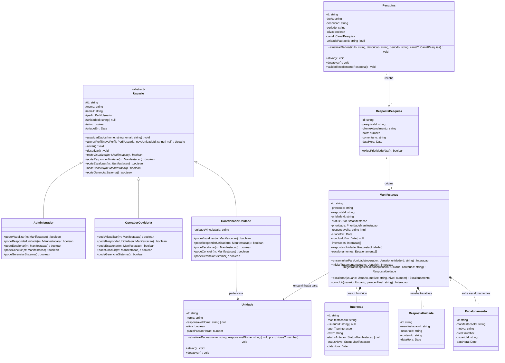

# 02. Modelagem Orientada a Objetos (POO) e Regras de Domínio — Plataforma de Experiência do Cliente (Cedro / NIT)

Este documento detalha como os conceitos de **Programação Orientada a Objetos (POO)** exigidos pelo professor são aplicados diretamente no domínio da **Plataforma de Experiência do Cliente (Cedro / NIT)** em **TypeScript** (sistema próprio que substitui o antigo INDECX).

---

## 1. Os 4 Pilares de POO Aplicados ao Projeto

Para atender tanto à avaliação acadêmica de POO quanto às regras funcionais da [Documentacao_Funcional_INDECX.pdf](file:///c:/Users/gabri/poo-taino-gabriel/Documentacao_Funcional_INDECX.pdf), o sistema implementa os 4 pilares de forma explícita e justificável:

| Pilar de POO | Onde é aplicado na Plataforma (Cedro / NIT) | Regra da Documentação Funcional Atendida |
| :--- | :--- | :--- |
| **1. Abstração** | Classe abstrata `Usuario` e interfaces `IRepository<T>` e `INotificador`. | Separa o conceito essencial de um usuário interno e de uma notificação dos detalhes técnicos de banco ou envio. |
| **2. Herança** | Subclasses `Administrador`, `OperadorOuvidoria` e `CoordenadorUnidade` herdando de `Usuario`. | Seção 3 (*Perfis de acesso*): Cada perfil herda dados comuns (`id`, `nome`, `email`, `status`), mas possui capacidades específicas. |
| **3. Polimorfismo** | Métodos `podeVisualizar(m)`, `podeResponder(m)`, `podeEscalonar(m)` e `podeConcluir(m)` sobrescritos (`override`) em cada subclasse de `Usuario`, além das implementações de `INotificador`. | Seção 6 (*Regras de negócio*): *"As permissões devem restringir a visualização por perfil e, quando aplicável, por unidade"* e *"Apenas usuários autorizados da unidade podem registrar a resposta"*. |
| **4. Encapsulamento** | Atributos `private` na classe `Manifestacao` (`_status`, `_interacoes`, `_respostasUnidade`, `_escalonamentos`, `_concluidoEm`). | Seção 6: Impede que o status mude sem registrar `Interacao` (usuário, data/hora) e impede concluir sem antes ter uma `RespostaUnidade`. |

---

## 2. Diagrama de Classes UML Completo (`domain/entities`)



---

## 3. Máquina de Estados e Regras de Negócio Encapsuladas

A tabela abaixo especifica as transições permitidas dentro da classe `Manifestacao` (Seções 4, 5 e 6 da documentação funcional):

| Método na Classe `Manifestacao` | Status de Origem Permitidos | Novo Status Gerado | Quem pode executar (Polimorfismo) | Regra de Negócio Validada |
| :--- | :--- | :--- | :--- | :--- |
| `criarAPartirDaResposta()` *(Factory)* | `(Inexistente)` | `NOVA` (ou direto `NAO_RESPONDIDA` ao vincular unidade) | Sistema (Automático ao responder pesquisa) | Gera protocolo único e registra a 1ª `Interacao` de abertura. Se nota $\le 2$, define prioridade `ALTA`. |
| `encaminharParaUnidade()` | `NOVA` | `NAO_RESPONDIDA` | `OperadorOuvidoria` ou `Administrador` | Vincula a unidade responsável e registra `Interacao` com usuário e data/hora. |
| `iniciarTratamento()` | `NAO_RESPONDIDA`, `ESCALONADA` | `EM_TRATAMENTO` | `CoordenadorUnidade` (da mesma unidade) | Registra que a unidade assumiu a análise do caso. |
| `registrarRespostaUnidade()` | `NAO_RESPONDIDA`, `EM_TRATAMENTO`, `ESCALONADA` | `RESPONDIDA` | `CoordenadorUnidade` (exclusivo da unidade vinculada) | Exige texto não vazio; cria objeto `RespostaUnidade` e gera `Interacao` mudando status para `RESPONDIDA`. |
| `escalonar()` | `NAO_RESPONDIDA`, `EM_TRATAMENTO` | `ESCALONADA` | `OperadorOuvidoria`, `Administrador` ou Job de Prazo | Exige motivo e nível; eleva prioridade para `CRITICA`, cria `Escalonamento` sem apagar o histórico anterior. |
| `concluir()` | `RESPONDIDA` | `CONCLUIDA` | `OperadorOuvidoria` ou `Administrador` | **Bloqueia** se `respostasUnidade.length === 0`. Preenche `concluidoEm` e bloqueia alterações futuras. |

---

## 4. Especificação de Referência do Código POO (TypeScript)

Abaixo está o modelo de referência de como as classes principais serão implementadas em `backend/src/domain/`:

### 4.1. Hierarquia Polimórfica de `Usuario`
```typescript
export enum PerfilUsuario {
  OPERADOR_OUVIDORIA = 'OPERADOR_OUVIDORIA',
  COORDENADOR_UNIDADE = 'COORDENADOR_UNIDADE',
  ADMINISTRADOR = 'ADMINISTRADOR',
}

export abstract class Usuario {
  constructor(
    public readonly id: string,
    protected _nome: string,
    protected _email: string,
    public readonly perfil: PerfilUsuario,
    public readonly unidadeId: string | null,
    protected _ativo: boolean = true,
    public readonly criadoEm: Date = new Date()
  ) {}

  get nome(): string { return this._nome; }
  get email(): string { return this._email; }
  get ativo(): boolean { return this._ativo; }

  // Métodos de negócio para Edição e Soft Delete (Inativação Lógica)
  public atualizarDados(nome: string, email: string): void {
    if (!nome || !nome.trim()) throw new Error('O nome do usuário é obrigatório.');
    if (!email || !email.includes('@')) throw new Error('Um e-mail válido é obrigatório.');
    this._nome = nome.trim();
    this._email = email.trim();
  }

  public alterarPerfil(novoPerfil: PerfilUsuario, novaUnidadeId: string | null = null): Usuario {
    if (novoPerfil === PerfilUsuario.COORDENADOR_UNIDADE && (!novaUnidadeId || !novaUnidadeId.trim())) {
      throw new Error('Coordenador de Unidade deve estar obrigatoriamente vinculado a uma unidade.');
    }
    return UsuarioFactory.criar({
      id: this.id,
      nome: this._nome,
      email: this._email,
      perfil: novoPerfil,
      unidadeId: novoPerfil === PerfilUsuario.COORDENADOR_UNIDADE ? novaUnidadeId : null,
      ativo: this._ativo,
      criadoEm: this.criadoEm,
    });
  }

  public ativar(): void { this._ativo = true; }
  public desativar(): void { this._ativo = false; }

  // Métodos polimórficos: cada subclasse define sua regra de acesso
  abstract podeVisualizar(unidadeDaManifestacaoId: string): boolean;
  abstract podeResponderUnidade(unidadeDaManifestacaoId: string): boolean;
  abstract podeEscalonar(): boolean;
  abstract podeConcluir(): boolean;
  abstract podeGerenciarSistema(): boolean;
}

export class CoordenadorUnidade extends Usuario {
  constructor(id: string, nome: string, email: string, unidadeId: string, ativo = true, criadoEm = new Date()) {
    if (!unidadeId) {
      throw new Error('Coordenador de Unidade deve estar obrigatoriamente vinculado a uma unidade.');
    }
    super(id, nome, email, PerfilUsuario.COORDENADOR_UNIDADE, unidadeId, ativo, criadoEm);
  }

  override podeVisualizar(unidadeDaManifestacaoId: string): boolean {
    return this._ativo && this.unidadeId === unidadeDaManifestacaoId;
  }

  override podeResponderUnidade(unidadeDaManifestacaoId: string): boolean {
    return this._ativo && this.unidadeId === unidadeDaManifestacaoId;
  }

  override podeEscalonar(): boolean { return false; }
  override podeConcluir(): boolean { return false; }
  override podeGerenciarSistema(): boolean { return false; }
}

export class OperadorOuvidoria extends Usuario {
  constructor(id: string, nome: string, email: string, ativo = true, criadoEm = new Date()) {
    super(id, nome, email, PerfilUsuario.OPERADOR_OUVIDORIA, null, ativo, criadoEm);
  }

  override podeVisualizar(_unidadeDaManifestacaoId: string): boolean { return this._ativo; }
  override podeResponderUnidade(_unidadeDaManifestacaoId: string): boolean { return false; }
  override podeEscalonar(): boolean { return this._ativo; }
  override podeConcluir(): boolean { return this._ativo; }
  override podeGerenciarSistema(): boolean { return false; }
}

export class Administrador extends Usuario {
  constructor(id: string, nome: string, email: string, ativo = true, criadoEm = new Date()) {
    super(id, nome, email, PerfilUsuario.ADMINISTRADOR, null, ativo, criadoEm);
  }

  override podeVisualizar(_unidadeDaManifestacaoId: string): boolean { return this._ativo; }
  override podeResponderUnidade(_unidadeDaManifestacaoId: string): boolean { return false; }
  override podeEscalonar(): boolean { return this._ativo; }
  override podeConcluir(): boolean { return this._ativo; }
  override podeGerenciarSistema(): boolean { return this._ativo; }
}
```

### 4.2. Encapsulamento na Classe `Manifestacao`
* **Proibição de setters livres:** Não existe `manifestacao.status = 'CONCLUIDA'`.
* **Auditoria automática:** O método privado `alterarStatus(usuario, novoStatus, tipoInteracao, descricao)` é o único ponto interno capaz de trocar `this._status`, e ele **sempre** instancia um objeto `Interacao` registrando `statusAnterior`, `statusNovo`, `usuario.id` e `new Date()`, adicionando-o à lista privada `this._interacoes`.
* **Imutabilidade pós-conclusão:** Qualquer tentativa de chamar `registrarRespostaUnidade()` ou `escalonar()` quando `this._status === StatusManifestacao.CONCLUIDA` lança um `RegraNegocioError`.

### 4.3. Ciclo de Vida CRUD e *Soft Delete* (Desativação Lógica) nas Entidades
Em um sistema de Ouvidoria e Auditoria (Seções 6 e 13 da documentação funcional), **nenhum registro que possui histórico vinculado pode ser apagado fisicamente (`DELETE` no banco)**. Por isso, as classes `Unidade`, `Pesquisa` e `Usuario` encapsulam métodos explícitos de edição (`atualizarDados()`, `alterarPerfil()`) e inativação lógica (`desativar()` / `ativar()`):
* **`Unidade` (`ativa = false`):** Deixa de aparecer para seleção em novos atendimentos, mas preserva todo o histórico de manifestações passadas no Dashboard e nos Relatórios.
* **`Pesquisa` (`ativa = false`):** O método `validarRecebimentoResposta()` bloqueia imediatamente novas respostas no link público/QR Code, mantendo intactas todas as respostas e manifestações já originadas por ela.
* **`Usuario` (`ativo = false`):** Bloqueia imediatamente o login e todas as permissões polimórficas (`this._ativo` retorna `false`), mas preserva a autoria do usuário na trilha de auditoria (`interacoes`, `respostas_unidade` e `escalonamentos`).


