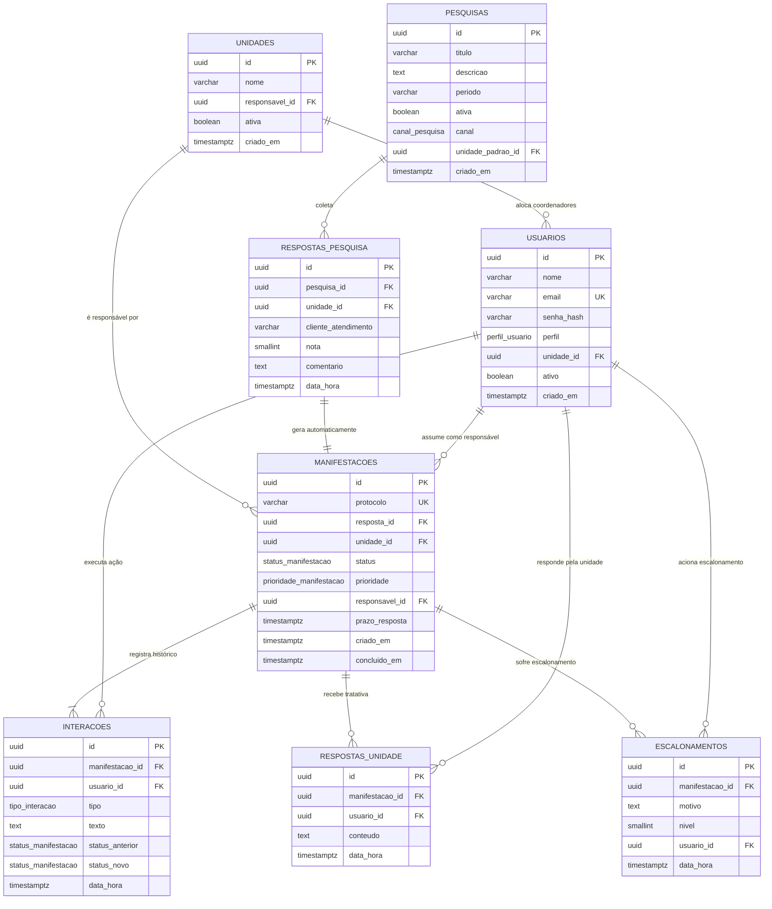

# 03. Modelagem do Banco de Dados (PostgreSQL / Supabase) — Plataforma de Experiência do Cliente (Cedro / NIT)

> **Responsável direto:** Gabriel (Frente: Banco de Dados)

Este documento define o Diagrama Entidade-Relacionamento (DER), o dicionário de dados das **8 entidades** exigidas na Seção 8 da [Documentacao_Funcional_INDECX.pdf](file:///c:/Users/gabri/poo-taino-gabriel/Documentacao_Funcional_INDECX.pdf) e o script SQL pronto para execução no **Supabase (PostgreSQL)**.

---

## 1. Diagrama Entidade-Relacionamento (DER)



---

## 2. Regras de Integridade e Auditoria no Banco de Dados (Seções 6 e 13)

Além da validação nas classes de POO, o banco de dados PostgreSQL aplica travas de segurança adicionais:
1. **Relação 1:1 Rastreável (`UNIQUE (resposta_id)` em `manifestacoes`):** Garante que toda resposta de pesquisa gere uma manifestação única e rastreável.
2. **Validação de Nota (`CHECK (nota BETWEEN 1 AND 5)`):** Impede notas fora da escala de 1 a 5.
3. **Vínculo Obrigatório de Coordenador (`CHECK` em `usuarios`):** Um usuário com perfil `COORDENADOR_UNIDADE` não pode ser salvo com `unidade_id IS NULL`.
4. **Proibição de Exclusão de Manifestação Concluída (Trigger PostgreSQL):** Atende à regra *"Nenhuma manifestação concluída deve ser apagada do histórico operacional"*.
5. **Imutabilidade do Histórico (`interacoes`):** Uma trigger impede `UPDATE` ou `DELETE` na tabela `interacoes`, garantindo trilha de auditoria imutável (Seção 13).

---

## 3. Script SQL Completo para Supabase (`PostgreSQL`)

Este script pode ser colado e executado diretamente no **SQL Editor** do Supabase:

```sql
-- Extensão para geração de UUIDs
CREATE EXTENSION IF NOT EXISTS "pgcrypto";

-- 1. Tipos ENUM do Domínio (Cedro / NIT)
CREATE TYPE perfil_usuario AS ENUM (
    'OPERADOR_OUVIDORIA',
    'COORDENADOR_UNIDADE',
    'ADMINISTRADOR'
);

CREATE TYPE canal_pesquisa AS ENUM (
    'LINK',
    'QR_CODE',
    'TOTEM',
    'WHATSAPP',
    'EMAIL'
);

CREATE TYPE status_manifestacao AS ENUM (
    'NOVA',
    'NAO_RESPONDIDA',
    'EM_TRATAMENTO',
    'ESCALONADA',
    'RESPONDIDA',
    'CONCLUIDA'
);

CREATE TYPE prioridade_manifestacao AS ENUM (
    'BAIXA',
    'MEDIA',
    'ALTA',
    'CRITICA'
);

CREATE TYPE tipo_interacao AS ENUM (
    'ABERTURA_AUTOMATICA',
    'ENCAMINHAMENTO',
    'INICIO_TRATAMENTO',
    'RESPOSTA_UNIDADE',
    'SOLICITACAO_COMPLEMENTO',
    'ESCALONAMENTO',
    'CONCLUSAO',
    'OBSERVACAO_INTERNA'
);

-- 2. Tabela: unidades
CREATE TABLE unidades (
    id UUID PRIMARY KEY DEFAULT gen_random_uuid(),
    nome VARCHAR(150) NOT NULL UNIQUE,
    responsavel_nome VARCHAR(150),
    ativa BOOLEAN NOT NULL DEFAULT TRUE,
    prazo_padrao_horas INT NOT NULL DEFAULT 48 CHECK (prazo_padrao_horas > 0),
    criado_em TIMESTAMPTZ NOT NULL DEFAULT NOW()
);

-- 3. Tabela: usuarios
CREATE TABLE usuarios (
    id UUID PRIMARY KEY DEFAULT gen_random_uuid(),
    nome VARCHAR(150) NOT NULL,
    email VARCHAR(255) NOT NULL UNIQUE,
    senha_hash VARCHAR(255) NOT NULL,
    perfil perfil_usuario NOT NULL,
    unidade_id UUID REFERENCES unidades(id) ON DELETE RESTRICT,
    ativo BOOLEAN NOT NULL DEFAULT TRUE,
    criado_em TIMESTAMPTZ NOT NULL DEFAULT NOW(),
    CONSTRAINT chk_coordenador_unidade CHECK (
        (perfil = 'COORDENADOR_UNIDADE' AND unidade_id IS NOT NULL)
        OR (perfil <> 'COORDENADOR_UNIDADE')
    )
);

-- 4. Tabela: pesquisas
CREATE TABLE pesquisas (
    id UUID PRIMARY KEY DEFAULT gen_random_uuid(),
    titulo VARCHAR(200) NOT NULL,
    descricao TEXT,
    periodo VARCHAR(100) NOT NULL,
    ativa BOOLEAN NOT NULL DEFAULT TRUE,
    canal canal_pesquisa NOT NULL DEFAULT 'LINK',
    unidade_padrao_id UUID REFERENCES unidades(id) ON DELETE SET NULL,
    criado_em TIMESTAMPTZ NOT NULL DEFAULT NOW()
);

-- 5. Tabela: respostas_pesquisa
CREATE TABLE respostas_pesquisa (
    id UUID PRIMARY KEY DEFAULT gen_random_uuid(),
    pesquisa_id UUID NOT NULL REFERENCES pesquisas(id) ON DELETE RESTRICT,
    unidade_id UUID NOT NULL REFERENCES unidades(id) ON DELETE RESTRICT,
    cliente_atendimento VARCHAR(150),
    nota SMALLINT NOT NULL CHECK (nota BETWEEN 1 AND 5),
    comentario TEXT,
    data_hora TIMESTAMPTZ NOT NULL DEFAULT NOW()
);

-- 6. Tabela: manifestacoes
CREATE TABLE manifestacoes (
    id UUID PRIMARY KEY DEFAULT gen_random_uuid(),
    protocolo VARCHAR(30) NOT NULL UNIQUE,
    resposta_id UUID NOT NULL UNIQUE REFERENCES respostas_pesquisa(id) ON DELETE RESTRICT,
    unidade_id UUID NOT NULL REFERENCES unidades(id) ON DELETE RESTRICT,
    status status_manifestacao NOT NULL DEFAULT 'NAO_RESPONDIDA',
    prioridade prioridade_manifestacao NOT NULL DEFAULT 'MEDIA',
    responsavel_id UUID REFERENCES usuarios(id) ON DELETE SET NULL,
    prazo_resposta TIMESTAMPTZ NOT NULL,
    criado_em TIMESTAMPTZ NOT NULL DEFAULT NOW(),
    concluido_em TIMESTAMPTZ,
    CONSTRAINT chk_data_conclusao CHECK (
        (status = 'CONCLUIDA' AND concluido_em IS NOT NULL)
        OR (status <> 'CONCLUIDA' AND concluido_em IS NULL)
    )
);

-- 7. Tabela: interacoes (Histórico Imutável de Auditoria)
CREATE TABLE interacoes (
    id UUID PRIMARY KEY DEFAULT gen_random_uuid(),
    manifestacao_id UUID NOT NULL REFERENCES manifestacoes(id) ON DELETE RESTRICT,
    usuario_id UUID REFERENCES usuarios(id) ON DELETE RESTRICT,
    tipo tipo_interacao NOT NULL,
    texto TEXT NOT NULL,
    status_anterior status_manifestacao,
    status_novo status_manifestacao NOT NULL,
    data_hora TIMESTAMPTZ NOT NULL DEFAULT NOW()
);

-- 8. Tabela: respostas_unidade
CREATE TABLE respostas_unidade (
    id UUID PRIMARY KEY DEFAULT gen_random_uuid(),
    manifestacao_id UUID NOT NULL REFERENCES manifestacoes(id) ON DELETE RESTRICT,
    usuario_id UUID NOT NULL REFERENCES usuarios(id) ON DELETE RESTRICT,
    conteudo TEXT NOT NULL CHECK (char_length(trim(conteudo)) > 0),
    data_hora TIMESTAMPTZ NOT NULL DEFAULT NOW()
);

-- 9. Tabela: escalonamentos
CREATE TABLE escalonamentos (
    id UUID PRIMARY KEY DEFAULT gen_random_uuid(),
    manifestacao_id UUID NOT NULL REFERENCES manifestacoes(id) ON DELETE RESTRICT,
    motivo TEXT NOT NULL CHECK (char_length(trim(motivo)) > 0),
    nivel SMALLINT NOT NULL DEFAULT 1 CHECK (nivel >= 1),
    usuario_id UUID NOT NULL REFERENCES usuarios(id) ON DELETE RESTRICT,
    data_hora TIMESTAMPTZ NOT NULL DEFAULT NOW()
);

-- 10. Índices para os Filtros da Seção 10 e Dashboard da Seção 11
CREATE INDEX idx_manifestacoes_status ON manifestacoes(status);
CREATE INDEX idx_manifestacoes_unidade ON manifestacoes(unidade_id);
CREATE INDEX idx_manifestacoes_criado_em ON manifestacoes(criado_em);
CREATE INDEX idx_manifestacoes_protocolo ON manifestacoes(protocolo);
CREATE INDEX idx_respostas_nota ON respostas_pesquisa(nota);
CREATE INDEX idx_respostas_pesquisa_id ON respostas_pesquisa(pesquisa_id);

-- 11. Triggers de Imutabilidade e Segurança (Seções 6 e 13)
CREATE OR REPLACE FUNCTION fn_bloquear_alteracao_historico()
RETURNS TRIGGER AS $$
BEGIN
    RAISE EXCEPTION 'O histórico de interações é imutável e não pode ser alterado ou excluído.';
END;
$$ LANGUAGE plpgsql;

CREATE TRIGGER trg_interacoes_imutavel
BEFORE UPDATE OR DELETE ON interacoes
FOR EACH ROW EXECUTE FUNCTION fn_bloquear_alteracao_historico();

CREATE OR REPLACE FUNCTION fn_bloquear_exclusao_manifestacao_concluida()
RETURNS TRIGGER AS $$
BEGIN
    IF OLD.status = 'CONCLUIDA' THEN
        RAISE EXCEPTION 'Nenhuma manifestação concluída pode ser apagada do histórico operacional.';
    END IF;
    RETURN OLD;
END;
$$ LANGUAGE plpgsql;

CREATE TRIGGER trg_proteger_manifestacao_concluida
BEFORE DELETE ON manifestacoes
FOR EACH ROW EXECUTE FUNCTION fn_bloquear_exclusao_manifestacao_concluida();
```

