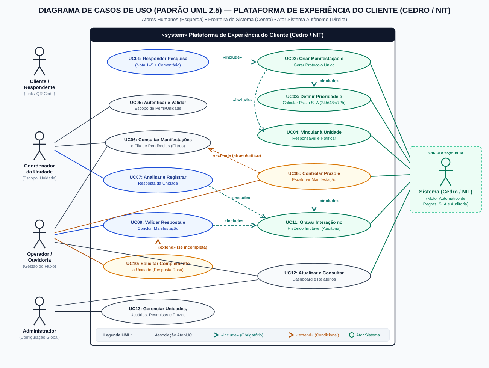
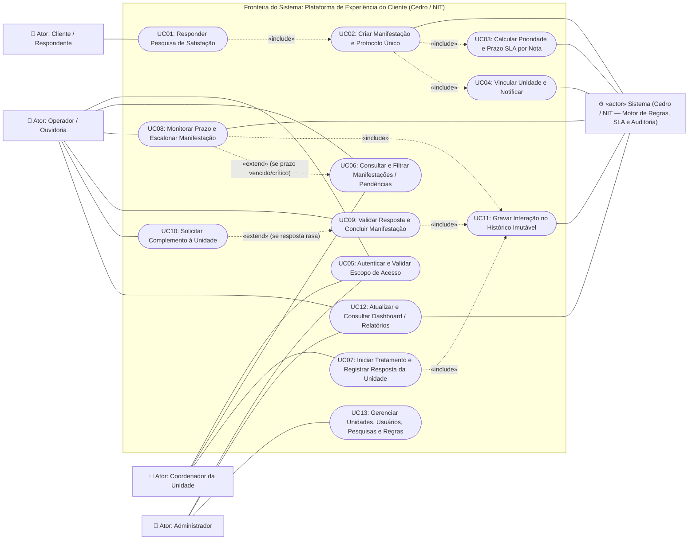
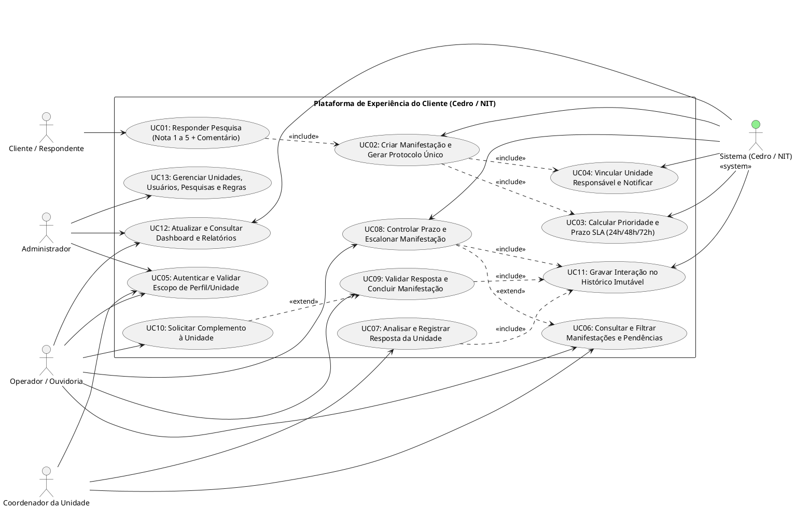
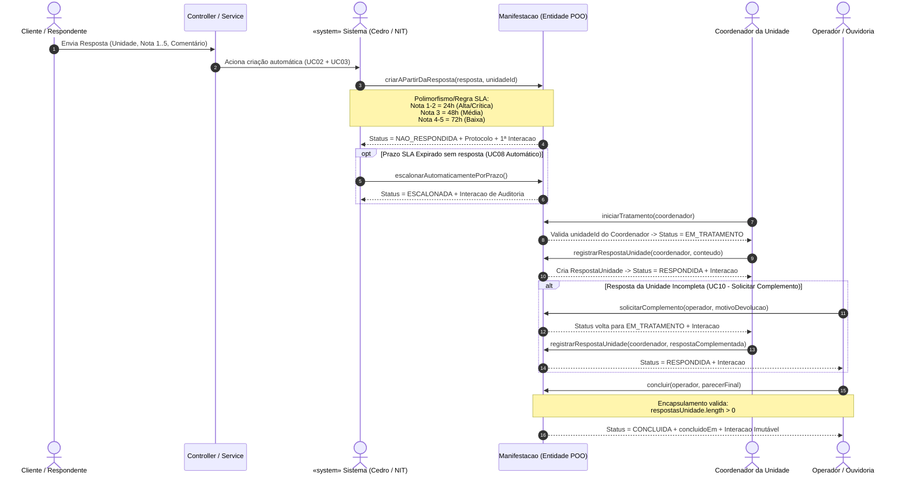

# 05. Diagrama de Casos de Uso (Padrão UML) e Justificativa Coerente de POO — Plataforma de Experiência do Cliente (Cedro / NIT)

> **Responsável:** Gabriel (`Tech Lead` / Arquitetura UML & POO)

Este documento consolida a modelagem comportamental da **Plataforma de Experiência do Cliente (Cedro / NIT)** (sistema próprio desenvolvido para substituir o antigo INDECX), destacando:
1. O **Diagrama de Casos de Uso no Padrão UML 2.5**, trazendo explicitamente os **4 Atores Humanos** (na esquerda) e o **Ator Sistema (`<<actor>> <<system>> Sistema Cedro / NIT`)** (na direita).
2. As relações formais **`<<include>>`** (inclusão obrigatória) e **`<<extend>>`** (extensão condicional).
3. O **Diagrama de Sequência UML** do ciclo de vida completo.
4. A **Justificativa Coerente de POO**, provando que cada pilar de Orientação a Objetos existe para resolver uma regra real de negócio da [Documentacao_Funcional_INDECX.pdf](file:///c:/Users/gabri/poo-taino-gabriel/Documentacao_Funcional_INDECX.pdf).

---

## 1. Por que o "Sistema (Cedro / NIT)" é modelado como Ator na UML?

Na Seção 4 (*Fluxo principal*) e na Seção 12 (*Notificações e automações*) da [Documentacao_Funcional_INDECX.pdf](file:///c:/Users/gabri/poo-taino-gabriel/Documentacao_Funcional_INDECX.pdf), diversas ações **não** dependem de clique manual de um operador humano — elas são disparadas ou executadas autonomamente pelo motor de regras e temporizador de SLA do próprio sistema:

* *"2. **Sistema** registra nota, comentário, data/hora e referência do atendimento."*
* *"3. **Sistema** cria a manifestação."*
* *"6. **Sistema** acompanha prazo e status."*
* *"Seção 12: Alertar quando uma manifestação permanecer sem resposta pelo prazo configurado / Atualizar automaticamente os contadores do dashboard / Registrar automaticamente no histórico todas as ações relevantes."*

Na UML 2.5, modelamos esse comportamento autônomo/temporizado à direita da fronteira do sistema como o ator **`<<actor>> <<system>> Sistema (Cedro / NIT) — Motor de Regras, SLA e Auditoria`**.

---

## 2. Diagrama de Casos de Uso — Padrão Visual UML 2.5

O diagrama vetorial abaixo ([diagrama-casos-de-uso-uml.svg](file:///c:/Users/gabri/poo-taino-gabriel/docs/diagrama-casos-de-uso-uml.svg)) utiliza a notação clássica da UML (Bonecos Palito para Atores, Retângulo de Fronteira do Sistema, Elipses para Casos de Uso e setas tracejadas abertas para `<<include>>` e `<<extend>>`):

---

### 2.1. Visão Estrutural em Mermaid (Renderização Rápida no Markdown)

---

### 2.2. Código PlantUML Oficial (Para exportar em ferramentas CASE / Slides da Apresentação)

Se precisarem colar no **PlantUML**, **Draw.io** ou **Astah** para a apresentação do professor:

---

## 3. Especificação Tabular dos Casos de Uso (Com Regras Fechadas)

| Código | Caso de Uso | Ator Primário | Participação do Ator Sistema | Regra de Negócio Consolidada |
| :---: | :--- | :--- | :--- | :--- |
| **UC01** | Responder Pesquisa de Satisfação | `Cliente / Respondente` | Valida campos e aciona `UC02` via `<<include>>`. | Unidade e Nota (1 a 5) são obrigatórios; Identificação do cliente é opcional (LGPD); Comentário é obrigatório para notas 1 a 3. |
| **UC02** | Criar Manifestação e Gerar Protocolo | `Sistema (Cedro / NIT)` | Cria registro único `CED-AAAA-NNNNNN` vinculado 1:1 à resposta. | **Toda** resposta (1 a 5) gera uma Manifestação rastreável e já nasce com status `NAO_RESPONDIDA` vinculada à Unidade do atendimento. |
| **UC03** | Definir Prioridade e Calcular Prazo SLA | `Sistema (Cedro / NIT)` | Calcula prioridade e vencimento conforme a nota recebida. | **Nota 1:** `CRITICA` (SLA 24h) • **Nota 2:** `ALTA` (SLA 24h) • **Nota 3:** `MEDIA` (SLA 48h) • **Nota 4-5:** `BAIXA` (SLA 72h). |
| **UC04** | Vincular Unidade e Notificar | `Sistema (Cedro / NIT)` / `Ouvidoria` | Vincula a unidade de origem da pesquisa e dispara notificação. | A Ouvidoria pode redirecionar a unidade posteriormente caso o cliente tenha selecionado a unidade errada. |
| **UC05** | Autenticar e Validar Escopo | Usuários Internos | Verifica credenciais e instancia a classe polimórfica de `Usuario`. | Bloqueia usuários inativos e carrega o escopo de permissão por perfil e unidade. |
| **UC06** | Consultar Manifestações e Pendências | `Coordenador`, `Ouvidoria`, `Admin` | Aplica os 9 filtros da Seção 10 e restringe visibilidade por unidade. | `CoordenadorUnidade` enxerga exclusivamente manifestações da sua `unidadeId`. |
| **UC07** | Analisar e Registrar Resposta da Unidade | `Coordenador da Unidade` | Muda status para `EM_TRATAMENTO` / `RESPONDIDA` e aciona `UC11`. | Apenas o coordenador autorizado daquela unidade específica pode registrar a resposta formal. |
| **UC08** | Controlar Prazo e Escalonar Manifestação | `Sistema (Cedro / NIT)` / `Ouvidoria` | Monitora `prazo_resposta < agora` e permite escalonamento híbrido (automático ou manual). | Eleva status para `ESCALONADA` e prioridade para `CRITICA` sem perder nenhum item do histórico anterior. |
| **UC09** | Validar Resposta e Concluir Manifestação | `Operador / Ouvidoria` | Verifica existência de `RespostaUnidade` antes de permitir conclusão. | **Impossível concluir** sem resposta formal prévia da Unidade. Após concluída, torna-se imutável e nunca pode ser excluída. |
| **UC10** | Solicitar Complemento à Unidade (`<<extend>>`) | `Operador / Ouvidoria` | Retorna status de `RESPONDIDA` para `EM_TRATAMENTO` e notifica unidade. | Acionado quando a resposta da Unidade é rasa ou insuficiente; exige justificativa que fica gravada no histórico (`UC11`). |
| **UC11** | Gravar Interação no Histórico Imutável | `Sistema (Cedro / NIT)` | Executado via `<<include>>` em toda mudança de status. | Registra `usuarioId`, `tipo`, `texto`, `statusAnterior`, `statusNovo` e `dataHora`. |
| **UC12** | Atualizar e Consultar Dashboard / Relatórios | `Ouvidoria`, `Admin`, `Sistema` | Atualiza contadores automaticamente após mudanças de status. | Calcula os 10 indicadores da Seção 11 (volume, % por nota, SLA médio de resposta e conclusão, pendências por unidade). |
| **UC13** | Gerenciar Unidades, Usuários e Pesquisas | `Administrador` | Persiste parâmetros e valida regras estruturais. | Garante que todo `COORDENADOR_UNIDADE` possua uma `Unidade` ativa associada. |

---

## 4. Diagrama de Sequência UML (Ciclo Completo com Ator Sistema e Devolução)

---

## 5. Justificativa Coerente dos Pilares de POO (Para Apresentação ao Professor)

Como definido pelo **Gabriel (Tech Lead)**, nenhum pilar de POO foi colocado "por enfeite". Abaixo está a defesa técnica de como cada conceito de POO resolve um problema real da **Plataforma de Experiência do Cliente (Cedro / NIT)**:

| Conceito POO | Implementação no Código | Por que é 100% coerente e necessário neste sistema? |
| :--- | :--- | :--- |
| **Encapsulamento** | Atributos `private` em `Manifestacao` (`_status`, `_interacoes`, `_respostasUnidade`, `_concluidoEm`) sem *setters* públicos. | Se `_status` fosse público (`manifestacao.status = 'CONCLUIDA'`), qualquer dev poderia pular a exigência de ter uma resposta da unidade ou esquecer de gravar a auditoria (`Interacao`). O encapsulamento torna **impossível** violar as regras da Seção 6 do PDF. |
| **Herança** | Classe abstrata `Usuario` com subclasses `Administrador`, `OperadorOuvidoria` e `CoordenadorUnidade`. | Todos os usuários internos compartilham autenticação, identificação e trilha de auditoria, mas o `CoordenadorUnidade` possui estado próprio obrigatório (`unidadeId` vinculada) que os demais perfis não possuem. |
| **Polimorfismo** | Métodos `podeVisualizar(m)`, `podeResponderUnidade(m)`, `podeEscalonar()` e `podeConcluir()` sobrescritos em cada subclasse de `Usuario`, + política de cálculo de SLA (`PoliticaSlaPorNota`). | Em vez de espalhar `if (usuario.perfil === 'COORDENADOR' && usuario.unidadeId === ...)` em dezenas de lugares da API, a própria entidade `Manifestacao` pergunta polimorficamente `usuario.podeResponderUnidade(this.unidadeId)`. |
| **Abstração** | Interfaces `IManifestacaoRepository`, `IUsuarioRepository` e `INotificador`. | Permite testar 100% das regras de negócio e casos de QA em memória sem depender de internet ou do Supabase estar online no momento do teste. |
