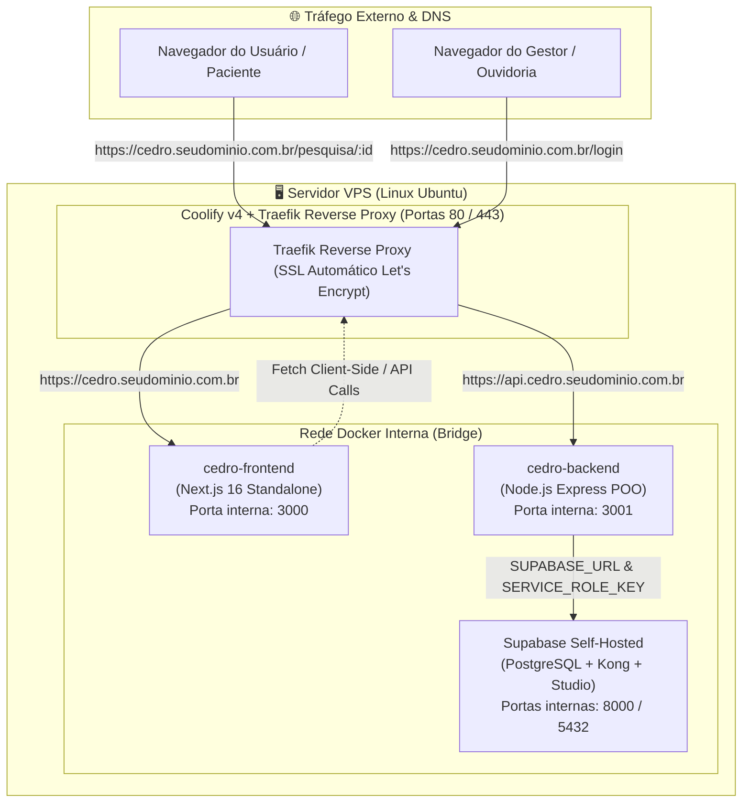

# Guia Oficial de Deploy em VPS com Coolify v4
## Plataforma de Experiência do Cliente — Laboratório Cedro / NIT

Este guia documenta o passo a passo completo, atualizado e validado para realizar o deploy em ambiente de produção da **Plataforma de Experiência do Cliente do Laboratório Cedro** em uma **VPS Linux** utilizando o **Coolify v4** (PaaS *self-hosted* moderno baseado em Docker e Traefik).

---

## 1. Visão Geral da Arquitetura em Produção

O Coolify v4 atua como orquestrador dos contêineres Docker na sua VPS, gerenciando compilações automáticas, variáveis de ambiente, roteamento de rede interna e emissão automática de certificados SSL (HTTPS via Let's Encrypt através do Traefik Reverse Proxy).



### Componentes do Projeto:
1. **Banco de Dados (Supabase Self-Hosted ou PostgreSQL):** Armazena dados de unidades, usuários, pesquisas, respostas e manifestações com tipos ENUM e extensão `pgcrypto`.
2. **Back-end API (Express POO):** Localizado em `/backend`, expõe a API RESTful na porta interna `3001` sob o domínio `https://api.cedro.seudominio.com.br`.
3. **Front-end (Next.js 16 App Router):** Localizado em `/frontend`, executado em modo `output: 'standalone'` na porta interna `3000` sob o domínio `https://cedro.seudominio.com.br`.

---

## 2. Requisitos de Infraestrutura e Preparação da VPS

### 2.1. Especificações Mínimas Recomendadas
* **Provedor:** Hetzner Cloud, DigitalOcean, Linode/Akamai, AWS Lightsail, Contabo ou Oracle Cloud.
* **Sistema Operacional:** Ubuntu 22.04 LTS ou Ubuntu 24.04 LTS (instalação limpa).
* **CPU:** Mínimo 2 vCPUs (4 vCPUs recomendadas para builds rápidos do Next.js).
* **Memória RAM:** Mínimo 4 GB de RAM (para rodar Supabase + Docker builds sem travamentos).
* **Armazenamento:** Mínimo 40 GB SSD / NVMe.

### 2.2. Portas Liberadas no Firewall (Security Group / UFW)
Garanta que as seguintes portas estejam abertas para a VPS:
* `22/TCP`: Acesso SSH para administração.
* `80/TCP`: HTTP padrão (redirecionado automaticamente para HTTPS pelo Traefik).
* `443/TCP`: HTTPS com certificado SSL Let's Encrypt.
* `8000/TCP`: Porta padrão para o primeiro acesso ao painel do Coolify.

### 2.3. Configuração de Memória Swap (Fundamental para Builds do Next.js)
Para evitar que o compilador do Next.js sofra *Out of Memory (OOM)* durante o build, execute no terminal SSH da sua VPS:

```bash
# Cria um arquivo de Swap de 4GB
sudo fallocate -l 4G /swapfile
sudo chmod 600 /swapfile
sudo mkswap /swapfile
sudo swapon /swapfile

# Torna permanente no boot
echo '/swapfile none swap sw 0 0' | sudo tee -a /etc/fstab

# Verifica se o swap está ativo
free -h
```

---

## 3. Instalação Oficial do Coolify v4 na VPS

Execute o comando oficial de instalação do Coolify via SSH:

```bash
# Atualiza os pacotes básicos
sudo apt update && sudo apt upgrade -y && sudo apt install curl -y

# Executa o script de instalação oficial do Coolify v4
curl -fsSL https://cdn.coollabs.io/coolify/install.sh | bash
```

Após o término da instalação (cerca de 2 a 3 minutos):
1. Abra no navegador: `http://<IP_DA_SUA_VPS>:8000`.
2. Cadastre o usuário Administrador (Nome, E-mail e Senha segura).
3. Na tela inicial do Coolify, selecione **Localhost** (o servidor onde o Coolify está instalado).
4. *(Opcional, porém recomendado)*: Em **Settings**, configure um domínio FQDN para o próprio painel do Coolify (ex: `https://coolify.seudominio.com.br`) para ter HTTPS seguro no gerenciador.

---

## 4. Configuração de DNS (Apontamento de Domínios)

No seu gerenciador de domínio (Cloudflare, Registro.br, Hostinger, GoDaddy, etc.), crie os registros **Tipo A** apontando para o endereço IPv4 público da sua VPS:

| Tipo | Nome / Host | Destino (IP da VPS) | Descrição |
| :--- | :--- | :--- | :--- |
| **A** | `cedro` (ou `@`) | `123.45.67.89` | Interface do Front-end (`cedro.seudominio.com.br`) |
| **A** | `api.cedro` | `123.45.67.89` | API Back-end Express (`api.cedro.seudominio.com.br`) |
| **A** | `supabase.cedro` | `123.45.67.89` | Supabase Studio / Kong (`supabase.cedro.seudominio.com.br`) *(se desejar expor o Studio)* |

> [!TIP]
> **Dica sobre Cloudflare:** Durante o primeiro deploy e a emissão do certificado Let's Encrypt pelo Traefik do Coolify, recomenda-se deixar a nuvem cinza (*DNS Only*) ou certificar-se de que o modo de criptografia SSL/TLS no Cloudflare está definido como **Full (strict)**.

---

## 5. Passo a Passo do Deploy

### Etapa 1: Provisionar o Banco de Dados (Supabase no Coolify)

Como o Back-end da Plataforma Cedro utiliza o cliente `@supabase/supabase-js`, a forma mais conveniente é utilizar o **Template Supabase** nativo do Coolify:

1. No painel do Coolify, acesse **Projects** ➔ selecione o projeto (ou clique em **+ Add** e crie `Laboratorio Cedro`).
2. Clique no ambiente **production** ➔ clique em **+ New Resource**.
3. Selecione a aba **Service Templates** ➔ escolha **Supabase**.
4. O Coolify criará automaticamente o ecossistema com:
   * PostgreSQL com extensões `pgcrypto` e `pgvector`.
   * Kong API Gateway.
   * Supabase Studio (Interface Web de Gerenciamento).
   * GoTrue / PostgREST.
5. Em **Domains**, defina o domínio do Supabase Studio (ex: `https://supabase.cedro.seudominio.com.br`).
6. Clique em **Deploy**.
7. Quando o serviço estiver ativo (*Healthy*):
   * Abra a aba **Environment Variables** do Supabase no Coolify e anote:
     - `SERVICE_SUPABASEANON_KEY` (chave anônima pública).
     - `SERVICE_SUPABASESERVICE_KEY` (chave `service_role` com privilégios de administrador).
     - `JWT_SECRET` (segredo do token).

#### Executando a Estrutura do Banco (DDL e Seed):
1. Acesse o **Supabase Studio** pelo navegador (`https://supabase.cedro.seudominio.com.br`).
2. No menu lateral esquerdo, clique no ícone **SQL Editor**.
3. Clique em **+ New Query**:
   * Abra o arquivo [database/schema.sql](file:///C:/Users/Taino/Desktop/poo-taino-gabriel/database/schema.sql) deste repositório, copie todo o conteúdo e cole no SQL Editor.
   * Clique em **Run**. Todas as tabelas (`unidades`, `usuarios`, `pesquisas`, `respostas_pesquisa`, `manifestacoes`, `interacoes`) e ENUMs serão criados.
4. Crie outra query no SQL Editor:
   * Abra o arquivo [database/seed.sql](file:///C:/Users/Taino/Desktop/poo-taino-gabriel/database/seed.sql), copie todo o conteúdo e cole no SQL Editor.
   * Clique em **Run**. As unidades modelo, usuários iniciais (com senhas criptografadas via bcrypt) e pesquisas de teste serão inseridos com sucesso.

---

### Etapa 2: Deploy do Back-end (Node.js Express POO)

1. No Coolify, dentro do projeto `Laboratorio Cedro`, clique em **+ New Resource**.
2. Selecione **Git Based** ➔ **Public Repository** (ou conecte seu GitHub via **GitHub App** se for privado):
   * **Repository URL:** `https://github.com/TainoSamuelDEV/LaboratorioCedro.git`
   * **Branch:** `prod`
3. Configure os parâmetros da aplicação:
   * **Build Pack:** Selecione `Dockerfile`.
   * **Base Directory:** `/backend`
   * **Dockerfile Location:** `/backend/Dockerfile`
   * **Ports Exposes:** `3001`
   * **Domains:** `https://api.cedro.seudominio.com.br`
   * **Watch Paths:** `/backend/**` *(evita rebuilds desnecessários quando alterações forem apenas no frontend)*.
4. Acesse a aba **Environment Variables** e adicione as seguintes variáveis:

```env
PORT=3001
NODE_ENV=production
JWT_SECRET=cedro_secret_key_super_segura_producao_2026_nit_poo
JWT_EXPIRES_IN=8h
SUPABASE_URL=http://supabase-kong:8000
SUPABASE_SERVICE_ROLE_KEY=cole_aqui_a_sua_service_role_key_gerada_pelo_supabase
```

> [!NOTE]
> Se o Supabase estiver rodando na mesma rede Docker gerenciada pelo Coolify, você pode usar a URL interna direta `http://supabase-kong:8000` (ou o nome do contêiner do Kong). Caso contrário, use a URL pública completa `https://supabase.cedro.seudominio.com.br`.

5. Clique em **Deploy**.
6. Acompanhe os logs de build. Quando concluído, o status mudará para verde (*Healthy*).
7. Teste a saúde da API no navegador ou via curl:
   ```bash
   curl https://api.cedro.seudominio.com.br/api/pesquisas/publica/c1d2e3f4-a5b6-4c7d-8e9f-111111111111
   ```
   A API deve responder com o JSON da pesquisa pública da Unidade Matriz Central.

---

### Etapa 3: Deploy do Front-end (Next.js 16 Standalone)

1. No Coolify, clique novamente em **+ New Resource**.
2. Selecione **Git Based** (mesmo repositório `https://github.com/TainoSamuelDEV/LaboratorioCedro.git`, branch `prod`).
3. Configure os parâmetros da aplicação:
   * **Build Pack:** Selecione `Dockerfile`.
   * **Base Directory:** `/frontend`
   * **Dockerfile Location:** `/frontend/Dockerfile`
   * **Ports Exposes:** `3000`
   * **Domains:** `https://cedro.seudominio.com.br`
   * **Watch Paths:** `/frontend/**`
4. Acesse a aba **Environment Variables** do Front-end:

> [!IMPORTANT]
> **REGRA CRÍTICA DO NEXT.JS NO COOLIFY v4:**
> Variáveis que começam com `NEXT_PUBLIC_` são embutidas (*hardcoded*) pelo compilador Turbopack do Next.js nos arquivos JavaScript estáticos durante o comando `RUN npm run build` dentro do Docker.
> Por isso, no Coolify, a variável **PRECISA** estar marcada com a flag **Build-time**!

No modo **Developer View** das variáveis de ambiente do Coolify, insira exatamente:

```env
# coolify: buildtime=true runtime=true
NEXT_PUBLIC_API_URL=https://api.cedro.seudominio.com.br

PORT=3000
NODE_ENV=production
```

*(Se estiver usando o modo visual tradicional do Coolify, adicione `NEXT_PUBLIC_API_URL`, valor `https://api.cedro.seudominio.com.br`, e certifique-se de marcar a opção **"Available during build"** / **"Build-time"**).*

5. Clique em **Deploy**.
6. O Coolify executará o build multi-stage do Next.js 16:
   * Estágio `builder` compila as 16 rotas estáticas e dinâmicas (`output: 'standalone'`).
   * Estágio `runner` monta o contêiner ultra-enxuto com apenas os arquivos necessários (`server.js`, `.next/static` e `public`).
7. Quando o status mudar para verde (*Healthy*), acesse `https://cedro.seudominio.com.br`.

---

## 6. Configuração de CI/CD Automático (GitHub Webhooks)

Para que qualquer `git push origin prod` realize o deploy automático das novas alterações:

1. No Coolify, abra a aplicação desejada (ex: Front-end ou Back-end).
2. Acesse a aba **Webhooks**.
3. Copie a URL do **Deploy Webhook** (ex: `https://coolify.seudominio.com.br/api/v1/deploy?uuid=...`).
4. No GitHub:
   * Abra o repositório `https://github.com/TainoSamuelDEV/LaboratorioCedro`.
   * Vá em **Settings** ➔ **Webhooks** ➔ **Add webhook**.
   * Cole a URL do Coolify no campo **Payload URL**.
   * Em **Content type**, selecione `application/json`.
   * Em **Which events would you like to trigger this webhook?**, selecione **Just the push event**.
   * Clique em **Add webhook**.
5. Repita o processo para o Back-end.
6. Pronto! Agora, quando você enviar commits para o branch `prod`, o Coolify recompilará automaticamente apenas a parte do monorepo afetada (graças aos `Watch Paths` configurados).

---

## 7. Checklist de Homologação Pós-Deploy

Execute os seguintes testes práticos em produção:

- [ ] **Acesso ao Front-end:** Acesse `https://cedro.seudominio.com.br` e confirme que a tela de login corporativo do Laboratório Cedro carrega com logotipo oficial, estilização Tailwind e fontes carregadas.
- [ ] **Autenticação:** Faça login com as credenciais padrão do `seed.sql`:
  - **E-mail:** `admin@cedro.com.br`
  - **Senha:** `cedro123`
- [ ] **Dashboard Gerencial:** Verifique se os cards analíticos (NPS, CSAT, Total de Manifestações e Respostas) carregam dados do banco sem erros 500 ou avisos de CORS no console do navegador (F12).
- [ ] **Módulo de Pesquisas:** Acesse `/pesquisas`, visualize as pesquisas cadastradas e abra o modal de criação de nova pesquisa.
- [ ] **Totem / Placa de QR Code em PDF:**
  - Na listagem de pesquisas, clique em **"Usar QR Code / Totem"**.
  - No modal de alta fidelidade visual, verifique a renderização do título da pesquisa, unidade vinculada, descrição e o QR Code centralizado com as cores da identidade Cedro.
  - Clique em **"Imprimir Totem / Salvar em PDF"** e valide a geração da página para impressão física A4.
- [ ] **Formulário Público do Paciente:**
  - Escaneie o QR Code com a câmera do celular ou acesse diretamente `https://cedro.seudominio.com.br/pesquisa/<ID_DA_PESQUISA>`.
  - Envie uma nota de 1 a 5 com um comentário.
  - Confirme que a resposta foi registrada e, caso a nota tenha sido 1 ou 2, confirme que uma **Manifestação Crítica** foi aberta automaticamente em `/manifestacoes`.
- [ ] **Módulos de Unidades e Usuários:**
  - Acesse `/unidades` e `/usuarios`.
  - Abra uma página de detalhe `/unidades/[id]` e `/usuarios/[id]`.
  - Teste a edição cadastral e confirme a persistência dos dados no banco.

---

## 8. Guia de Resolução de Problemas (Troubleshooting)

### Problema 1: O Front-end tenta fazer requisições para `http://localhost:3001` em vez do domínio de produção
* **Causa:** A variável `NEXT_PUBLIC_API_URL` não foi disponibilizada durante a fase de build no Coolify, fazendo com que o Next.js utilizasse o valor de *fallback* local.
* **Solução:** No Coolify, abra as variáveis de ambiente da aplicação Front-end, ative o switch **Build-time** para `NEXT_PUBLIC_API_URL` (ou use `# coolify: buildtime=true runtime=true`) e clique em **Redeploy**.

### Problema 2: Erro de CORS no Console do Navegador (`Cross-Origin Request Blocked`)
* **Causa:** O navegador bloqueou requisições entre o domínio do frontend (`cedro.seudominio.com.br`) e o do backend (`api.cedro.seudominio.com.br`).
* **Solução:** O arquivo [backend/src/presentation/app.ts](file:///C:/Users/Taino/Desktop/poo-taino-gabriel/backend/src/presentation/app.ts#L69) utiliza `app.use(cors())`, que aceita todas as origens por padrão. Certifique-se de que a URL configurada no `NEXT_PUBLIC_API_URL` contenha o protocolo `https://` correto (ex: `https://api.cedro.seudominio.com.br`).

### Problema 3: Falha de compilação por falta de memória RAM durante o `npm run build`
* **Causa:** O compilador Turbopack do Next.js atinge o limite de RAM de uma VPS com 2GB ou menos.
* **Solução:** Configure a memória Swap de 4GB descrita na [Seção 2.3](#23-configuração-de-memória-swap-fundamental-para-builds-do-nextjs) deste guia.

### Problema 4: Certificado SSL Let's Encrypt não emite
* **Causa:** Os apontamentos DNS no Cloudflare/Registro.br ainda não propagaram ou o Cloudflare está interceptando o desafio HTTP-01 do Let's Encrypt.
* **Solução:** No Cloudflare, defina a nuvem como cinza (*DNS Only*) temporariamente até que o Coolify emita o certificado SSL, ou certifique-se de que o modo SSL do Cloudflare esteja configurado como **Full (strict)**.

### Problema 5: Como visualizar logs de diagnóstico diretamente pelo terminal
Se precisar inspecionar contêineres diretamente via SSH na VPS:

```bash
# Lista todos os contêineres ativos gerenciados pelo Coolify
docker ps

# Visualiza os logs em tempo real do Back-end
docker logs -f $(docker ps -qf "name=cedro-backend")

# Visualiza os logs em tempo real do Front-end
docker logs -f $(docker ps -qf "name=cedro-frontend")
```
