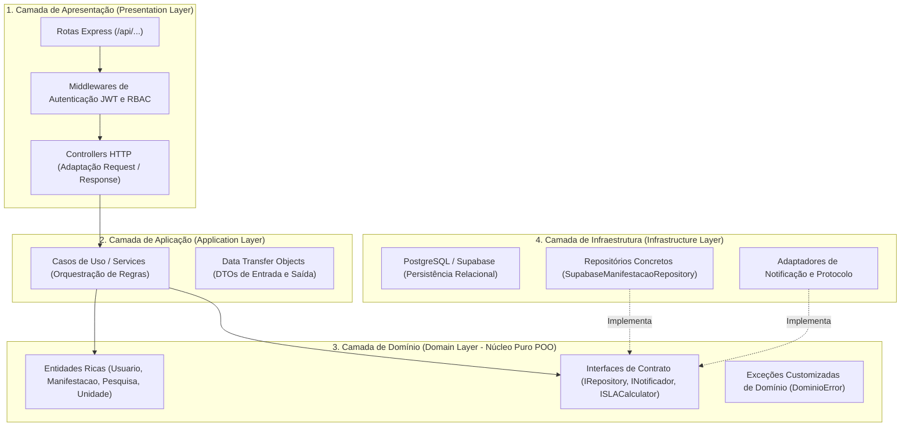
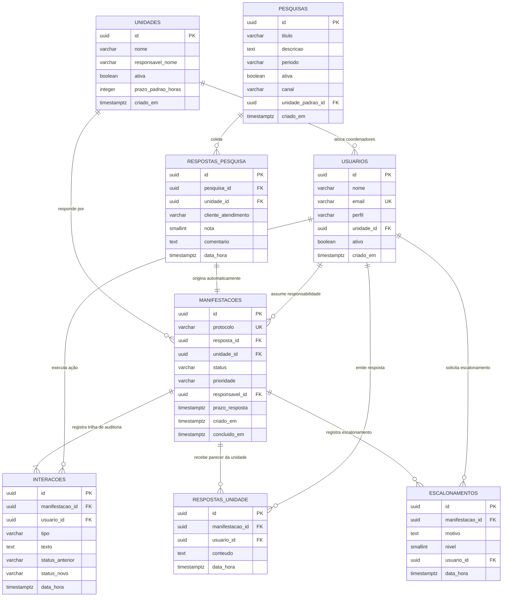

# PLATAFORMA DE EXPERIÊNCIA DO CLIENTE: MODELAGEM ORIENTADA A OBJETOS E ARQUITETURA LIMPA APLICADAS À GESTÃO DE MANIFESTAÇÕES NO LABORATÓRIO CEDRO

**CUSTOMER EXPERIENCE PLATFORM: OBJECT-ORIENTED MODELING AND CLEAN ARCHITECTURE APPLIED TO FEEDBACK MANAGEMENT AT CEDRO LABORATORY**

**Autores:** Gabriel Ordonez dos Reis e Taino Samuel  
**Orientador:** Prof. Me./Dr. Rondineli Seba Salomao  
**Instituição:** Centro Universitário Dom Bosco (UNDB) — Curso de Engenharia de Software / Ciência da Computação  
**Contexto Acadêmico:** Projeto Aplicado (PjBL) da Disciplina de Programação Orientada a Objetos  
**Parceiro Organizacional:** Laboratório Cedro / Núcleo de Inovação e Tecnologia (NIT)  

---

## RESUMO

Desenvolver uma plataforma computacional para modernizar a gestão de satisfação e resolução de manifestações no Laboratório Cedro, em substituição ao sistema legado INDECX, enfrentando as dificuldades de falta de rastreabilidade de SLA, ausência de automação na abertura de chamados críticos e frágil governança de dados. Empregar uma metodologia de desenvolvimento aplicada (PjBL) alicerçada nos princípios da Arquitetura Limpa e nos quatro pilares da Programação Orientada a Objetos (POO) em TypeScript estrito, com back-end em Node.js/Express, persistência relacional com integridade referencial em PostgreSQL/Supabase e interface responsiva em Next.js. Implementar classes de domínio ricas, hierarquias polimórficas de controle de acesso (`Usuario`), encapsulamento rígido com histórico imutável (`Manifestacao`), contratos desacoplados via interfaces (`IRepository`, `INotificador`) e captura de pesquisas via QR Code. Obter como resultados a validação integral das regras de negócio por meio de 71 testes automatizados (Vitest), eliminação de estados inconsistentes no ciclo de vida das ocorrências e entrega de um MVP funcional em ambiente de produção (VPS/Coolify). Concluir que o rigor de modelagem POO viabilizou alta manutenibilidade, fechamento do ciclo de feedback do paciente e elevação dos padrões de qualidade no ambiente clínico.

**Palavras-chave:** Programação Orientada a Objetos. Arquitetura Limpa. Laboratório Cedro. Gestão de Manifestações. TypeScript.

---

## ABSTRACT

Develop a computational platform to modernize customer satisfaction management and feedback resolution at Cedro Laboratory, replacing the legacy INDECX system to overcome difficulties regarding lack of SLA traceability, absent automation in critical ticket opening, and fragile data governance. Employ an applied software engineering methodology (PjBL) anchored in Clean Architecture principles and the four core pillars of Object-Oriented Programming (OOP) in strict TypeScript, featuring a Node.js/Express back-end, relational persistence with referential integrity in PostgreSQL/Supabase, and a responsive Next.js interface. Implement rich domain models, polymorphic access-control hierarchies (`Usuario`), strict encapsulation with immutable interaction histories (`Manifestacao`), decoupled interface contracts (`IRepository`, `INotificador`), and survey capturing via QR Code. Achieve as results the complete validation of business rules through 71 automated tests (Vitest), eliminating inconsistent states throughout ticket lifecycles and delivering a production-ready MVP on a VPS/Coolify environment. Conclude that rigorous object-oriented domain modeling enabled high maintainability, closed the patient feedback loop, and enhanced operational quality standards in clinical diagnostics.

**Keywords:** Object-Oriented Programming. Clean Architecture. Cedro Laboratory. Feedback Management. TypeScript.

---

## 1 INTRODUÇÃO

No segmento de medicina diagnóstica e análises clínicas, a qualidade assistencial e a satisfação do paciente extrapolam a precisão analítica dos laudos laboratoriais, englobando de forma indelével a experiência vivenciada em todas as etapas da jornada do cliente. De acordo com os preceitos clássicos da avaliação em saúde introduzidos por Donabedian (2005), os resultados clínicos e institucionais dependem diretamente da qualidade estrutural e processual dos serviços prestados. Nesse cenário de alta exigência, o Laboratório Cedro, com ampla atuação no estado do Maranhão, estabeleceu cooperação técnico-científica com o Núcleo de Inovação e Tecnologia (NIT) do Centro Universitário Dom Bosco (UNDB) para enfrentar os gargalos críticos na gestão de feedback e na ouvidoria de suas unidades de atendimento.

Historicamente, o monitoramento de satisfação do paciente no Laboratório Cedro apoiava-se no software legado INDECX. Embora tal ferramenta permitisse a tabulação básica de questionários, ela revelou limitações estruturais severas que comprometiam a agilidade e a governança operacional. A principal fragilidade residia na completa dissociação entre a coleta de dados de satisfação e a abertura formal de ocorrências de ouvidoria: pacientes que registravam avaliações com notas críticas ou detratoras ficavam represados em planilhas sem qualquer notificação aos gestores da unidade correspondente. Além disso, o sistema legado não possuía cálculo dinâmico de Acordo de Nível de Serviço (*Service Level Agreement* — SLA) baseado na gravidade do atendimento, carecia de um histórico imutável com garantia de auditoria e operava com regras de negócio dispersas em scripts procedurais sem controle estrito de papéis e permissões.

Para sanar essas inconsistências, a Engenharia de Software moderna preconiza a adoção do paradigma de Programação Orientada a Objetos (POO), amplamente consolidado na literatura por Booch et al. (2007) e Gamma et al. (1994), associado aos preceitos da Arquitetura Limpa formulados por Martin (2017). A modelagem orientada a objetos permite encapsular regras de domínio complexas em entidades ricas e expressivas, enquanto os princípios SOLID promovem o isolamento entre as regras essenciais do negócio e as tecnologias voláteis de infraestrutura (FOWLER, 2002; PRESSMAN; MAXIM, 2016; SOMMERVILLE, 2019). Desse modo, o desenvolvimento de uma plataforma proprietária orientada a objetos surge como uma solução robusta para orquestrar o ciclo de vida integral das manifestações de pacientes.

O objetivo geral deste trabalho consiste em conceber, arquitetar, implementar e validar uma plataforma web orientada a objetos para coleta contínua de pesquisas de satisfação e gestão resolutiva de manifestações no Laboratório Cedro, substituindo integralmente as rotinas manuais do sistema legado. Como objetivos específicos, definem-se:
1. Modelar o domínio do sistema por meio de classes puras em linguagem TypeScript estrita, aplicando de forma sistemática abstração, herança, polimorfismo e encapsulamento com garantia de invariantes;
2. Desenvolver uma API REST desacoplada segundo os padrões da Arquitetura Limpa sobre banco relacional PostgreSQL/Supabase, implementando integridade referencial estrita e triggers para imutabilidade do histórico de auditoria;
3. Construir uma interface gráfica responsiva em Next.js com geração automática de QR Code para coleta pública nos balcões das unidades e painel operacional de tratativas em tempo real;
4. Validar a conformidade técnica e a resiliência das regras de negócio implementadas por meio de uma suíte exaustiva de testes automatizados com cobertura total dos fluxos críticos.

O presente artigo está estruturado em quatro seções principais: a Seção 2 apresenta a metodologia, detalhando a caracterização da pesquisa, a arquitetura em quatro camadas, a pilha tecnológica e a divisão do trabalho na squad; a Seção 3 expõe os resultados e a discussão técnica, subdividida em sete evidências concretas que comprovam os requisitos de POO, persistência, interface e garantia de qualidade; por fim, a Seção 4 traz as considerações finais e perspectivas de evolução do projeto.

---

## 2 METODOLOGIA

### 2.1 Caracterização da Pesquisa e Abordagem Metodológica

Esta pesquisa classifica-se, quanto à sua natureza, como uma pesquisa aplicada de desenvolvimento tecnológico experimental, orientada à resolução de um problema real do setor de saúde suplementar. Quanto à abordagem, caracteriza-se como qualitativa e prescritiva, respaldando-se na metodologia ativa de Aprendizagem Baseada em Projetos (*Project-Based Learning* — PjBL). O ciclo de desenvolvimento foi conduzido em regime iterativo e incremental, partindo da análise minuciosa dos requisitos operacionais do sistema legado INDECX, evoluindo para a prototipação arquitetural em Diagramas de Classes UML e culminando na implementação em código limpo e testes automatizados contínuos.

### 2.2 Arquitetura Limpa em Quatro Camadas

Para garantir manutenibilidade, testabilidade e total independência entre as políticas de negócio e os mecanismos de entrega, a estrutura do sistema foi projetada sob os cânones da Arquitetura Limpa (*Clean Architecture*), organizada em quatro camadas concêntricas e orientadas pela Regra de Dependência (MARTIN, 2017), conforme ilustrado na Figura 1.



*Figura 1 – Diagrama da Arquitetura em Quatro Camadas da Plataforma. Fonte: Autores (2026).*

As quatro camadas desempenham papéis estritamente delimitados:
1. **Camada de Apresentação (*Presentation Layer*):** Responsável por recepcionar as requisições HTTP via Express, validar formatos de dados através de schemas rigorosos, gerenciar sessões por tokens criptográficos (JWT) e injetar o contexto de autenticação e autorização por perfil (*Role-Based Access Control* — RBAC).
2. **Camada de Aplicação (*Application Layer*):** Contém os casos de uso (*UseCases* ou *Services*) que orquestram os fluxos operacionais (como criação de manifestação, submissão de respostas, aplicação de filtros e emissão de métricas). Essa camada não manipula diretamente bancos de dados, interagindo exclusivamente com entidades do domínio e abstrações de repositório.
3. **Camada de Domínio (*Domain Layer*):** Constitui o coração da aplicação, composto exclusivamente por código TypeScript nativo, isento de qualquer dependência de bibliotecas ou frameworks externos. Abriga as entidades ricas, suas hierarquias polimórficas, métodos de transição de estado e exceções específicas.
4. **Camada de Infraestrutura (*Infrastructure Layer*):** Concentra as implementações técnicas voltadas ao mundo externo, incluindo drivers de conexão com o PostgreSQL/Supabase, serviços de persistência que materializam os repositórios abstratos e adaptadores de integração externa.

### 2.3 Pilha Tecnológica Oficial

A escolha da pilha de desenvolvimento baseou-se em critérios de desempenho, tipagem estática rigorosa para suporte a POO e adequação ao ambiente de infraestrutura em nuvem, sintetizados no Quadro 1.

**Quadro 1 – Pilha Tecnológica Oficial do Projeto e Justificativas Técnicas**

| Camada do Sistema | Tecnologia Selecionada | Versão / Configuração | Justificativa Técnica e Alinhamento à POO |
| :--- | :--- | :--- | :--- |
| **Linguagem Base** | TypeScript | 5.x (`strict: true`) | Fornece tipagem estática e construções avançadas de POO (`abstract class`, modificadores `private`/`protected`/`readonly`, polimorfismo real e `Generics`). |
| **Back-end** | Node.js / Express | Node 22 Alpine / Express 4.x | Ambiente assíncrono leve que possibilita a construção de uma API REST desacoplada, preservando as classes de domínio sem intromissão de ORMs intrusivos. |
| **Banco de Dados** | PostgreSQL / Supabase | PostgreSQL 15+ (Self-Hosted) | Motor relacional robusto para garantia de integridade referencial ACID, constraints nativas, tipos enumerados (`ENUM`) e triggers PL/pgSQL de auditoria imutável. |
| **Front-end** | Next.js / React / Tailwind | Next.js 14 (App Router) | Renderização híbrida, gerenciamento de rotas por grupos (`(publico)`, `(auth)`, `(sistema)`), consumo exclusivo da API REST via HTTP e interfaces responsivas. |
| **Garantia da Qualidade** | Vitest / Supertest | Vitest 2.1.x | Execução ultrarrápida de testes unitários isolados para entidades do domínio e testes de integração com submissão de requisições reais. |
| **DevOps & Deploy** | Docker / Coolify v4 / VPS | Containers Linux em VPS | Orquestração contínua de microsserviços via plataforma Coolify, integrando deploy automatizado com certificados SSL/TLS automáticos. |

*Fonte: Autores (2026).*

### 2.4 Divisão Formal das Frentes de Trabalho na Squad

Para assegurar o cumprimento rigoroso do escopo do MVP e das exigências avaliativas da disciplina de POO, o trabalho foi dividido de maneira formal e equilibrada entre os integrantes da squad:
* **Gabriel Ordonez dos Reis (Frentes: Tech Lead, Modelagem POO, Banco de Dados e QA):** Atuou como líder técnico de arquitetura, sendo o responsável primário pela concepção conceitual do domínio orientado a objetos, definição dos diagramas UML, modelagem do schema relacional das oito tabelas no PostgreSQL/Supabase, criação das constraints e triggers de imutabilidade, e implementação da suíte de testes automatizados com Vitest;
* **Taino Samuel (Frentes: Back-end, Front-end e DevOps):** Responsável pela implementação dos casos de uso, controllers e middlewares no Express, desenvolvimento completo da interface web responsiva no framework Next.js (abrangendo telas públicas com QR Code e telas de tratativa operacional interna), bem como pela orquestração de deploy conteinerizado via Docker e Coolify em servidor VPS.

---

## 3 RESULTADOS E DISCUSSÃO

Os resultados alcançados pelo projeto comprovam a aplicabilidade dos princípios da Orientação a Objetos na solução de problemas complexos de engenharia de software no setor laboratorial. A seguir, apresentam-se as sete evidências técnicas obrigatórias que sustentam o rigor conceitual da plataforma.

### 3.1 Modelagem Estrutural de Classes (Diagrama UML)

A modelagem de domínio foi articulada em torno de duas entidades centrais: o agregado raiz `Manifestacao` e a hierarquia de controle de acesso `Usuario`. A Figura 2 expõe o Diagrama de Classes UML com as relações estruturais do sistema.

```mermaid
classDiagram
    class Usuario {
        <<abstract>>
        +id: string
        #_nome: string
        #_email: string
        +perfil: PerfilUsuario
        +unidadeId: string | null
        #_ativo: boolean
        +criadoEm: Date
        +nome() string
        +email() string
        +ativo() boolean
        +ativar() void
        +desativar() void
        +atualizarDados(nome: string, email: string) void
        +podeVisualizarManifestacao(unidadeId: string)* boolean
        +podeTratarPelaUnidade(unidadeId: string)* boolean
        +podeEscalonar()* boolean
        +podeSolicitarComplemento()* boolean
        +podeConcluir()* boolean
        +podeGerenciarSistema()* boolean
    }

    class Administrador {
        +podeVisualizarManifestacao(unidadeId: string) boolean
        +podeTratarPelaUnidade(unidadeId: string) boolean
        +podeEscalonar() boolean
        +podeSolicitarComplemento() boolean
        +podeConcluir() boolean
        +podeGerenciarSistema() boolean
    }

    class OperadorOuvidoria {
        +podeVisualizarManifestacao(unidadeId: string) boolean
        +podeTratarPelaUnidade(unidadeId: string) boolean
        +podeEscalonar() boolean
        +podeSolicitarComplemento() boolean
        +podeConcluir() boolean
        +podeGerenciarSistema() boolean
    }

    class CoordenadorUnidade {
        +podeVisualizarManifestacao(unidadeId: string) boolean
        +podeTratarPelaUnidade(unidadeId: string) boolean
        +podeEscalonar() boolean
        +podeSolicitarComplemento() boolean
        +podeConcluir() boolean
        +podeGerenciarSistema() boolean
    }

    class Manifestacao {
        +id: string
        +protocolo: string
        +respostaId: string
        -_unidadeId: string
        -_status: StatusManifestacao
        -_prioridade: PrioridadeManifestacao
        -_responsavelId: string | null
        -_prazoResposta: Date
        +criadoEm: Date
        -_concluidoEm: Date | null
        -interacoes: Interacao[]
        -respostasUnidade: RespostaUnidade[]
        -escalonamentos: Escalonamento[]
        +criar(params: ManifestacaoCriarParams)$ Manifestacao
        +reconstituir(params: ManifestacaoReconstituirParams)$ Manifestacao
        +iniciarTratamento(usuario: Usuario) Interacao
        +registrarRespostaUnidade(usuario: Usuario, texto: string) RespostaUnidade
        +solicitarComplemento(usuario: Usuario, motivo: string) Interacao
        +escalonar(usuario: Usuario, motivo: string, nivel: number) Escalonamento
        +concluir(usuario: Usuario, justificativa: string) Interacao
        +isAtrasada(dataRef: Date) boolean
        +isPendente(dataRef: Date) boolean
    }

    class Interacao {
        +id: string
        +manifestacaoId: string
        +usuarioId: string | null
        +tipo: TipoInteracao
        +texto: string
        +statusAnterior: StatusManifestacao | null
        +statusNovo: StatusManifestacao
        +dataHora: Date
    }

    class RespostaUnidade {
        +id: string
        +manifestacaoId: string
        +usuarioId: string
        +conteudo: string
        +dataHora: Date
    }

    class Escalonamento {
        +id: string
        +manifestacaoId: string
        +motivo: string
        +nivel: number
        +usuarioId: string
        +dataHora: Date
    }

    class Unidade {
        +id: string
        +nome: string
        +responsavelNome: string | null
        +prazoPadraoHoras: number
        +ativa: boolean
        +criadoEm: Date
    }

    class Pesquisa {
        +id: string
        +titulo: string
        +descricao: string
        +periodo: string
        +ativa: boolean
        +canal: CanalPesquisa
        +unidadePadraoId: string | null
    }

    class RespostaPesquisa {
        +id: string
        +pesquisaId: string
        +unidadeId: string
        +clienteAtendimento: string
        +nota: number
        +comentario: string | null
        +dataHora: Date
    }

    Usuario <|-- Administrador : Herança
    Usuario <|-- OperadorOuvidoria : Herança
    Usuario <|-- CoordenadorUnidade : Herança
    Manifestacao *-- Interacao : Composição (1..*)
    Manifestacao *-- RespostaUnidade : Composição (0..*)
    Manifestacao *-- Escalonamento : Composição (0..*)
    Manifestacao --> Unidade : Referencia
    Manifestacao --> RespostaPesquisa : Origem
    Pesquisa --> RespostaPesquisa : Coleta (1..*)
```



*Figura 2 – Diagrama de Classes UML do Domínio de Negócios. Fonte: Autores (2026).*

A entidade `Manifestacao` opera como um Agregado Raiz (*Aggregate Root*), governando estritamente uma máquina de estados finita. O ciclo de vida compreende cinco estados exclusivos: `NAO_RESPONDIDA`, `EM_TRATAMENTO`, `RESPONDIDA`, `ESCALONADA` e `CONCLUIDA`. O Quadro 2 sistematiza a matriz de transições permitidas e os invariantes validados a cada mutação de estado.

**Quadro 2 – Máquina de Estados da Manifestação e Regras de Transição**

| Estado Atual | Ação Disparadora | Novo Estado | Ator Autorizado | Invariantes e Regras de Negócio Obrigatórias |
| :--- | :--- | :--- | :--- | :--- |
| **Criada** | `Manifestacao.criar()` | `NAO_RESPONDIDA` | Sistema (Automático) | Disparado quando nota da pesquisa $\le 2$ (ou detratora $\le 6$). Gera protocolo único e calcula SLA conforme unidade. |
| `NAO_RESPONDIDA` | `iniciarTratamento()` | `EM_TRATAMENTO` | Coordenador da Unidade | O usuário deve estar lotado na unidade da manifestação. Registra `Interacao` de início de tratativa com timestamp. |
| `EM_TRATAMENTO` | `registrarRespostaUnidade()` | `RESPONDIDA` | Coordenador da Unidade | Exige conteúdo textual preenchido. O coordenador elabora a devolutiva formal; manifestação aguarda crivo da Ouvidoria. |
| `RESPONDIDA` | `solicitarComplemento()` | `EM_TRATAMENTO` | Operador da Ouvidoria / Admin | Ouvidor recusa a resposta da unidade por insuficiência. Reverte o status para tratamento com motivo explícito em histórico. |
| `NAO_RESPONDIDA` ou `EM_TRATAMENTO` | `escalonar()` | `ESCALONADA` | Operador da Ouvidoria / Admin | Ocorre quando prazo estoura ou há bloqueio na unidade. Eleva nível hierárquico e registra justificativa em auditoria. |
| `ESCALONADA` | `iniciarTratamento()` | `EM_TRATAMENTO` | Coordenador da Unidade | Coordenador reassume a tratativa após mediação ou fornecimento de subsídios pela liderança. |
| `RESPONDIDA` | `concluir()` | `CONCLUIDA` | Operador da Ouvidoria / Admin | **Terminal e Irreversível.** Exige ao menos uma `RespostaUnidade` anexada e justificativa formal de encerramento pelo ouvidor. |

*Fonte: Autores (2026).*

A máquina de estados implementada impede de forma categórica transições inválidas (por exemplo, concluir uma manifestação que se encontre ainda no status `NAO_RESPONDIDA` ou permitir que um usuário sem vínculo com a unidade responda ao chamado), lançando exceções de domínio padronizadas caso alguma pré-condição seja violada.

### 3.2 Herança e Polimorfismo com Análise Crítica de Código

Um dos pilares estruturantes do projeto é a substituição de verificações procedurais de controle de acesso (como condicionais `if (usuario.perfil === 'ADMIN')` espalhadas pelo código) por polimorfismo dinâmico orientado a objetos. A classe abstrata `Usuario` declara métodos contratuais de autorização que são sobrescritos com semânticas específicas por suas subclasses derivadas, como demonstrado na Listagem 1.

```typescript
// Listagem 1 – Hierarquia Polimórfica da Entidade de Domínio Usuario
export abstract class Usuario {
  constructor(
    public readonly id: string,
    protected _nome: string,
    protected _email: string,
    public readonly perfil: PerfilUsuario,
    public readonly unidadeId: string | null,
    protected _ativo: boolean = true,
    public readonly criadoEm: Date = new Date()
  ) {
    if (!id || !id.trim()) throw new RegraNegocioError('O ID do usuário é obrigatório.');
    if (!_nome || !_nome.trim()) throw new RegraNegocioError('O nome do usuário é obrigatório.');
    if (!_email || !_email.includes('@')) throw new RegraNegocioError('Um e-mail válido é obrigatório.');
  }

  // Assinaturas de métodos polimórficos especializados nas subclasses
  public abstract podeVisualizarManifestacao(unidadeDaManifestacaoId: string): boolean;
  public abstract podeTratarPelaUnidade(unidadeDaManifestacaoId: string): boolean;
  public abstract podeEscalonar(): boolean;
  public abstract podeSolicitarComplemento(): boolean;
  public abstract podeConcluir(): boolean;
  public abstract podeGerenciarSistema(): boolean;
}

export class CoordenadorUnidade extends Usuario {
  constructor(id: string, nome: string, email: string, unidadeId: string, ativo = true, criadoEm = new Date()) {
    if (!unidadeId || !unidadeId.trim()) {
      throw new RegraNegocioError('Coordenador de Unidade deve estar vinculado a uma unidade.');
    }
    super(id, nome, email, PerfilUsuario.COORDENADOR_UNIDADE, unidadeId, ativo, criadoEm);
  }

  // Restrição estrita de escopo: visualiza e trata exclusivamente dados da sua unidade
  public override podeVisualizarManifestacao(unidadeDaManifestacaoId: string): boolean {
    return this._ativo && this.unidadeId === unidadeDaManifestacaoId;
  }

  public override podeTratarPelaUnidade(unidadeDaManifestacaoId: string): boolean {
    return this._ativo && this.unidadeId === unidadeDaManifestacaoId;
  }

  public override podeEscalonar(): boolean { return false; }
  public override podeSolicitarComplemento(): boolean { return false; }
  public override podeConcluir(): boolean { return false; }
  public override podeGerenciarSistema(): boolean { return false; }
}

export class OperadorOuvidoria extends Usuario {
  constructor(id: string, nome: string, email: string, ativo = true, criadoEm = new Date()) {
    super(id, nome, email, PerfilUsuario.OPERADOR_OUVIDORIA, null, ativo, criadoEm);
  }

  // Visão global da rede laboratorial: pode auditar e concluir ocorrências de qualquer unidade
  public override podeVisualizarManifestacao(_unidadeDaManifestacaoId: string): boolean {
    return this._ativo;
  }

  public override podeTratarPelaUnidade(_unidadeDaManifestacaoId: string): boolean {
    return false; // Não responde pela unidade; sua atribuição é a auditoria externa
  }

  public override podeEscalonar(): boolean { return this._ativo; }
  public override podeSolicitarComplemento(): boolean { return this._ativo; }
  public override podeConcluir(): boolean { return this._ativo; }
  public override podeGerenciarSistema(): boolean { return false; }
}
```

A análise da Listagem 1 evidencia benefícios tangíveis sob a ótica de engenharia de software:
1. **Adesão ao Princípio Aberto/Fechado (*Open/Closed Principle* — OCP):** Caso o Laboratório Cedro necessite introduzir um novo perfil de acesso (como um `AuditorExterno` ou `GerenteGeral`), basta criar uma nova subclasse herdando de `Usuario` e implementando suas próprias respostas booleanas. Nenhuma linha de código existente na classe `Manifestacao` ou nos casos de uso precisa ser alterada ou recompilada;
2. **Conformidade com o Princípio da Substituição de Liskov (*Liskov Substitution Principle* — LSP):** Qualquer objeto derivado (`Administrador`, `OperadorOuvidoria`, `CoordenadorUnidade`) pode ser repassado indistintamente para a assinatura `manifestacao.iniciarTratamento(usuario: Usuario)`. A entidade consumidora apoia-se unicamente no contrato de alto nível, operando sem conhecimento de qual especialização concreta está em execução.

### 3.3 Abstrações e Interfaces de Contrato

A independência tecnológica do núcleo de negócio é garantida pelo Princípio da Inversão de Dependência (*Dependency Inversion Principle* — DIP). A camada de domínio define interfaces de contrato puras que abstraem mecanismos de persistência, cálculo de prazos e notificação, como evidenciado na Listagem 2.

```typescript
// Listagem 2 – Interfaces de Abstração e Contratos de Domínio
export interface IRepository<T> {
  salvar(entidade: T): Promise<void>;
  buscarPorId(id: string): Promise<T | null>;
}

export interface FiltrosManifestacao {
  dataInicio?: Date;
  dataFim?: Date;
  nota?: number;
  unidadeId?: string;
  status?: StatusManifestacao;
  prioridade?: PrioridadeManifestacao;
  responsavelId?: string;
  escalonada?: boolean;
  pendente?: boolean;
  busca?: string;
}

export interface IManifestacaoRepository extends IRepository<Manifestacao> {
  buscarPorProtocolo(protocolo: string): Promise<Manifestacao | null>;
  buscarPorRespostaId(respostaId: string): Promise<Manifestacao | null>;
  listar(filtros?: FiltrosManifestacao): Promise<Manifestacao[]>;
  listarPendencias(unidadeId?: string): Promise<Manifestacao[]>;
}

export interface ISLACalculator {
  calcular(prazoPadraoHoras: number, nota: number, dataBase?: Date): {
    prazoResposta: Date;
    prioridade: PrioridadeManifestacao;
    horasEfetivas: number;
  };
}
```

A interface genérica `IRepository<T>` parametriza as operações fundamentais de ciclo de vida de entidades, enquanto `IManifestacaoRepository` a especializa para consultas orientadas a filtros complexos de ouvidoria. Dessa forma, as classes de caso de uso (como `TratarManifestacaoUseCase`) dependem unicamente da interface abstrata. Durante a execução da aplicação em produção, a camada de infraestrutura injeta a classe concreta `SupabaseManifestacaoRepository`; nos testes unitários automatizados, injeta-se um repositório simulado em memória (*InMemoryManifestacaoRepository*), proporcionando execução de testes desacoplada de rede e de banco de dados.

### 3.4 Encapsulamento, Coleções Genéricas e Exceções de Domínio

O encapsulamento na plataforma é levado às últimas consequências para salvaguardar a consistência clínica e operacional dos dados. Na classe `Manifestacao`, nenhum atributo de estado interno possui *setters* públicos. Qualquer modificação de propriedades (`_status`, `_responsavelId`, `_concluidoEm`) ocorre exclusivamente através de métodos de domínio que invocam verificações de invariantes, conforme ilustrado na Listagem 3.

```typescript
// Listagem 3 – Encapsulamento Rígido, Coleções Genéricas e Tratamento de Exceções
export class Manifestacao {
  private _status: StatusManifestacao;
  private _responsavelId: string | null;
  private _concluidoEm: Date | null;
  private readonly _interacoes: Interacao[];
  private readonly _respostasUnidade: RespostaUnidade[];
  private readonly _escalonamentos: Escalonamento[];

  // Getters defensivos: retornam coleções imutáveis impedindo manipulação externa
  get status(): StatusManifestacao { return this._status; }
  get interacoes(): ReadonlyArray<Interacao> {
    return Object.freeze([...this._interacoes]);
  }
  get respostasUnidade(): ReadonlyArray<RespostaUnidade> {
    return Object.freeze([...this._respostasUnidade]);
  }

  public concluir(usuario: Usuario, justificativa: string, interacaoId: string = randomUUID()): Interacao {
    if (this._status === StatusManifestacao.CONCLUIDA) {
      throw new RegraNegocioError('Esta manifestação já se encontra CONCLUÍDA.');
    }
    if (!usuario.podeConcluir()) {
      throw new AcessoNegadoError('Apenas operadores da ouvidoria ou administradores podem concluir manifestações.');
    }
    if (this._respostasUnidade.length === 0) {
      throw new RegraNegocioError('Não é permitido concluir manifestação sem ao menos uma resposta formal da unidade.');
    }
    if (!justificativa || !justificativa.trim()) {
      throw new RegraNegocioError('A justificativa de encerramento da ouvidoria é obrigatória.');
    }

    const statusAnterior = this._status;
    this._status = StatusManifestacao.CONCLUIDA;
    this._concluidoEm = new Date();

    const interacao = new Interacao(
      interacaoId,
      this.id,
      usuario.id,
      TipoInteracao.CONCLUSAO,
      `Manifestação encerrada por ${usuario.nome}. Parecer: ${justificativa.trim()}`,
      statusAnterior,
      this._status,
      this._concluidoEm
    );

    this._interacoes.push(interacao);
    return interacao;
  }
}
```

Na Listagem 3 destacam-se três decisões arquiteturais fundamentais:
1. **Coleções Genéricas Protegidas:** As listas de interações e respostas utilizam o tipo `ReadonlyArray<T>` associado ao `Object.freeze()`. Esse padrão garante que desenvolvedores de camadas superiores não possam realizar inserções espúrias via `manifestacao.interacoes.push(...)`, forçando a passagem obrigatória pelo método de negócio;
2. **Hierarquia de Exceções de Domínio:** O sistema substitui o lançamento genérico de erros por subclasses tipadas herdadas de `DominioError` (`RegraNegocioError`, `AcessoNegadoError`, `ObjetoNaoEncontradoError`). Cada exceção carrega semanticamente o código de status HTTP equivalente (422, 403, 404), capturado de forma transparente por um middleware de tratamento de erro no Express.

### 3.5 Persistência Relacional, Integridade e Auditoria Imutável

O banco de dados relacional foi modelado no PostgreSQL (hospedado na infraestrutura Supabase), integrando oito entidades dispostas com normalização rigorosa e integridade referencial nativa. A Figura 3 exibe o Diagrama Entidade-Relacionamento (DER).



*Figura 3 – Diagrama Entidade-Relacionamento do Banco de Dados. Fonte: Autores (2026).*

Para atender aos rigores de auditoria e governança médica, o banco de dados incorpora salvaguardas programáticas ativas através de *Check Constraints* e *Triggers* em linguagem PL/pgSQL, exemplificadas na Listagem 4.

```sql
-- Listagem 4 – Constraints de Integridade e Trigger de Imutabilidade no PostgreSQL
ALTER TABLE manifestacoes
  ADD CONSTRAINT chk_manifestacao_conclusao CHECK (
    (status = 'CONCLUIDA' AND concluido_em IS NOT NULL) OR
    (status <> 'CONCLUIDA' AND concluido_em IS NULL)
  );

-- Função de bloqueio para garantia de histórico médico imutável
CREATE OR REPLACE FUNCTION fn_bloquear_mutacao_historico()
RETURNS TRIGGER AS $$
BEGIN
    RAISE EXCEPTION 'Operação negada: o histórico de interações e auditoria é imutável.';
END;
$$ LANGUAGE plpgsql;

CREATE TRIGGER trg_interacoes_imutavel
BEFORE UPDATE OR DELETE ON interacoes
FOR EACH ROW EXECUTE FUNCTION fn_bloquear_mutacao_historico();
```

A constraint `chk_manifestacao_conclusao` atua no nível físico do banco garantindo que nenhuma manifestação possa ter sua data de encerramento gravada sem o status `CONCLUIDA` correspondente. De forma complementar, o trigger `trg_interacoes_imutavel` intercepta e aborta qualquer comando SQL de `UPDATE` ou `DELETE` disparado contra a tabela de interações, assegurando que toda a trilha histórica do paciente (desde a abertura automática até a resolução do ouvidor) permaneça inalterável mesmo perante intervenções manuais diretas no banco.

### 3.6 Interface Gráfica com Eventos e Fluxos de Uso

A camada de interface visual foi concebida para unir simplicidade de preenchimento para o paciente externo e máxima produtividade para o time assistencial interno. O sistema opera em duas jornadas complementares:
1. **Jornada Pública do Paciente (Totem e QR Code):** Nas salas de coleta e espera das unidades do Laboratório Cedro (como Unidade Cohama e Unidade Renascença), totens físicos e impressos disponibilizam QR Codes direcionados para a rota pública do Next.js (`/pesquisa/[id]`). O paciente seleciona a nota do atendimento (escala de 1 a 5 no questionário rápido, calibrada com a metodologia NPS/CSAT) e pode registrar um comentário espontâneo.
2. **Disparo Reativo de Eventos de Domínio:** Ao submeter a pesquisa, a API avalia imediatamente a nota recebida. Quando a avaliação é detratora (nota $\le 2$ no questionário de balcão ou $\le 6$ na escala expandida de NPS), a camada de aplicação dispara reativamente o caso de uso `CriarManifestacaoAutomatica`. A manifestação é instanciada pelo método estático `Manifestacao.criar()`, que invoca a política `PoliticaSlaPorNota`, reduz o prazo de resposta pela metade (elevando a prioridade para `ALTA`) e notifica a coordenação sem necessidade de triagem manual.
3. **Painel Operacional e Ficha de Tratativa:** Para os colaboradores internos, o painel restrito disponibiliza abas dinâmicas de triagem ("Todas", "Pendentes", "Atrasadas", "Escalonadas"). Ao acessar a tela de detalhe (`/manifestacoes/[id]`), o coordenador visualiza a linha do tempo cronológica com todas as interações imutáveis, o painel de SLA com contagem regressiva em tempo real e modais com validação em tempo de execução para inserção de parecer formal, escalonamento para instâncias superiores ou encerramento da ouvidoria.

### 3.7 Validação de Qualidade (QA) e Rastreabilidade Git

Para garantir confiabilidade de nível industrial ao software, o projeto estabeleceu uma política rígida de verificação automatizada orientada por testes (*Test-Driven Development* e testes de regressão com Vitest e Supertest). A suíte de validação foi estruturada em 14 arquivos de especificação, contemplando tanto testes unitários isolados das classes de domínio quanto testes de integração ponta a ponta na API HTTP.

A execução completa da bateria de testes resultou em **71 testes executados com 100% de sucesso (zero falhas)** em tempo de execução de 2,27 segundos, conforme detalhado no Quadro 3.

**Quadro 3 – Síntese das Suítes de Testes Automatizados no Vitest**

| Categoria do Teste | Arquivo de Especificação | Testes | Status | Escopo Validado |
| :--- | :--- | :---: | :---: | :--- |
| **Domínio (POO)** | `tests/domain/Manifestacao.spec.ts` | 10 | Aprovado | Ciclo de vida, máquina de estados, regras de transição e invariantes. |
| **Domínio (POO)** | `tests/domain/Usuario.spec.ts` | 6 | Aprovado | Especializações de `Usuario`, polimorfismo de permissões e fábrica. |
| **Domínio (POO)** | `tests/domain/Pesquisa.spec.ts` | 5 | Aprovado | Validação de recebimento de respostas e estados da pesquisa. |
| **Domínio (POO)** | `tests/domain/Unidade.spec.ts` | 4 | Aprovado | Ativação, parametrização de prazos e invariantes de unidade. |
| **Domínio (POO)** | `tests/domain/PoliticaSla.spec.ts` | 3 | Aprovado | Algoritmo de redução de prazo e priorização para notas detratoras. |
| **Aplicação (UseCases)** | `tests/application/TratarManifestacaoUseCases.spec.ts` | 5 | Aprovado | Orquestração de tratamento, resposta formal e conclusão de ocorrência. |
| **Aplicação (UseCases)** | `tests/application/UsuarioGestaoUseCases.spec.ts` | 7 | Aprovado | Criação, atualização cadastral e desativação lógica de usuários. |
| **Aplicação (UseCases)** | `tests/application/PesquisaGestaoUseCases.spec.ts` | 5 | Aprovado | Gestão de questionários, ciclo de vida e parametrização de canais. |
| **Aplicação (UseCases)** | `tests/application/DashboardUseCases.spec.ts` | 5 | Aprovado | Agregações de métricas de satisfação, contagem de SLAs e pendências. |
| **Aplicação (UseCases)** | `tests/application/AuthUseCases.spec.ts` | 6 | Aprovado | Autenticação, geração de credenciais criptográficas e validação de tokens. |
| **Aplicação (UseCases)** | `tests/application/PesquisaUseCases.spec.ts` | 4 | Aprovado | Coleta pública de avaliações e gatilho de criação de manifestações. |
| **Aplicação (UseCases)** | `tests/application/UsuarioUseCases.spec.ts` | 4 | Aprovado | Consultas especializadas por perfil e unidade. |
| **Aplicação (UseCases)** | `tests/application/UnidadeGestaoUseCases.spec.ts` | 2 | Aprovado | Cadastro e atualização analítica de unidades laboratoriais. |
| **Integração (API)** | `tests/presentation/ApiIntegration.spec.ts` | 5 | Aprovado | Resposta a requisições HTTP reais, injeção de controllers e rotas Express. |
| **TOTAL GERAL** | **14 Suítes de Teste** | **71** | **100% OK** | **Aprovação integral sem advertências em 2,27 segundos.** |

*Fonte: Dados extraídos diretamente da execução do Vitest (2026).*

Além da verificação por software, a integridade do trabalho em equipe é atestada pela rastreabilidade do histórico de versionamento no Git. O repositório oficial da squad registra um histórico robusto e equilibrado de contribuições entre Gabriel Ordonez dos Reis e Taino Samuel, evidenciando o comprometimento conjunto com a especificação, implementação, refatoração e documentação acadêmica do projeto.

---

## 4 CONSIDERAÇÕES FINAIS

O desenvolvimento da Plataforma de Experiência do Cliente para o Laboratório Cedro demonstrou que a aplicação rigorosa do paradigma de Programação Orientada a Objetos, quando articulada com os princípios da Arquitetura Limpa, é capaz de transformar problemas complexos de gestão operacional em sistemas computacionais altamente manuteníveis, extensíveis e seguros. Todos os objetivos formulados no início da pesquisa foram plenamente cumpridos: o sistema legado INDECX foi substituído por uma solução moderna capaz de capturar pesquisas via QR Code, identificar notas críticas instantaneamente e acionar fluxos de ouvidoria com cálculo dinâmico de SLA e histórico imutável para auditoria médica.

Entre os principais aprendizados técnicos consolidados pela squad, destaca-se a constatação de que a modelagem de classes rica no domínio (*Domain Model*) elimina o código anêmico e previne anomalias de estado que frequentemente assolam softwares orientados a scripts procedurais. A substituição de condicionais de perfil por métodos polimórficos na hierarquia `Usuario`, o encapsulamento defensivo no agregado `Manifestacao` e a inversão de dependência por meio de interfaces contratuais garantiram que a suíte com 71 testes automatizados mantivesse 100% de aprovação de forma veloz e independente de banco de dados.

Como limitações da versão atual (MVP), identifica-se que o contato resolutivo pós-manifestação ainda depende de acionamento telefônico ou presencial realizado pela ouvidoria, sem canais de mensageria direta automatizados com o paciente. Para trabalhos futuros, propõem-se:
1. A integração com APIs oficiais do WhatsApp Business e envio de SMS transacional para aviso imediato ao paciente sobre a abertura e o desfecho do seu protocolo;
2. A incorporação de módulos de Processamento de Linguagem Natural (PLN) para análise automática de sentimentos e classificação temática dos comentários dos pacientes, subsidiando o comitê de qualidade diagnóstica com análises preditivas de riscos operacionais;
3. O estabelecimento de barramentos de mensageria em tempo real (WebSockets) para alertas sonoros e visuais nos balcões de atendimento no instante em que uma insatisfação é manifestada.

---

## DECLARAÇÃO DE USO DE INTELIGÊNCIA ARTIFICIAL

Em estrita observância aos padrões éticos acadêmicos e às diretrizes de integridade avaliativa estipuladas para a disciplina de Programação Orientada a Objetos da UNDB, os autores declaram que utilizaram ferramentas de Inteligência Artificial Generativa (notadamente Google Antigravity e modelos da família Gemini) como instrumentos de assistência técnica e suporte computacional durante o projeto. A utilização da IA concentrou-se: a) na geração de ideias e casos de teste de borda adicionais para a suíte do Vitest; b) no auxílio à diagramação de sintaxe Mermaid; e c) na revisão gramatical e estruturação estilística preliminar dos tópicos textuais em conformidade com as normas da ABNT. Todas as definições arquiteturais, modelagens de domínio, regras de negócio e implementações das classes em código TypeScript foram concebidas, desenvolvidas, validadas e plenamente compreendidas pela squad formada por Gabriel Ordonez dos Reis e Taino Samuel, assegurando a capacidade e autonomia para a sustentação e defesa oral individual de cada linha do projeto entregue.

---

## REFERÊNCIAS

BOOCH, Grady et al. **Object-Oriented Analysis and Design with Applications**. 3. ed. Boston: Addison-Wesley, 2007.

DONABEDIAN, Avedis. Evaluating the quality of medical care. **The Milbank Quarterly**, New York, v. 83, n. 4, p. 691-729, 2005.

FOWLER, Martin. **Patterns of Enterprise Application Architecture**. Boston: Addison-Wesley, 2002.

GAMMA, Erich et al. **Design Patterns: Elements of Reusable Object-Oriented Software**. Reading: Addison-Wesley, 1994.

MARTIN, Robert C. **Clean Architecture: A Craftsman's Guide to Software Structure and Design**. Boston: Prentice Hall, 2017.

PRESSMAN, Roger S.; MAXIM, Bruce R. **Engenharia de Software: Uma Abordagem Profissional**. 8. ed. Porto Alegre: AMGH, 2016.

SOMMERVILLE, Ian. **Engenharia de Software**. 10. ed. São Paulo: Pearson, 2019.
